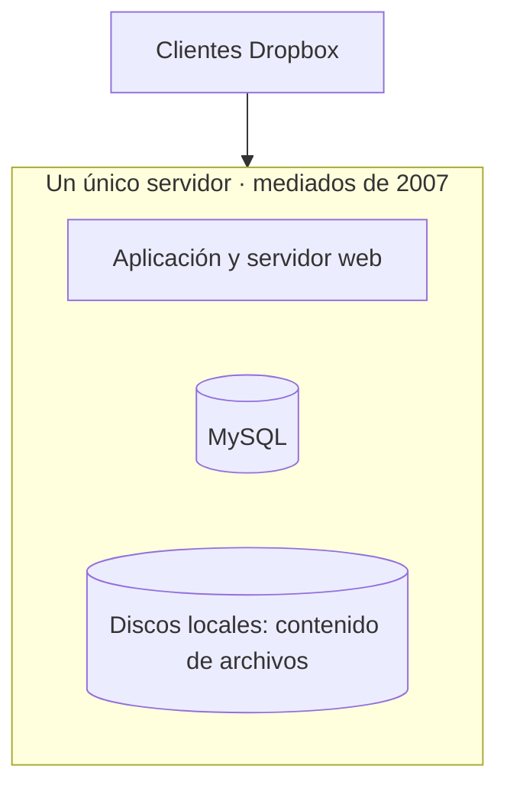
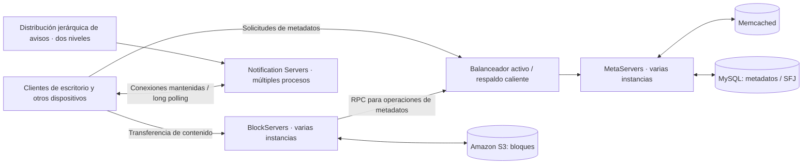

> **Nota.** Identificación y alcance de la fuente
> **Conferencia original:** *How We've Scaled Dropbox*. **Expositor:** Kevin Modzelewski, responsable del equipo de backend de Dropbox en el momento de la charla. **Ámbito:** Stanford EE380, 22 de febrero de 2012. La identidad del expositor, incorrectamente reconocida por Buzz como «Moduleski», y la fecha se contrastaron con la [ficha oficial de Stanford EE380](https://web.stanford.edu/class/ee380/Abstracts/120222.html). **Fuente técnica primaria:** los archivos de transcripción y subtítulos adjuntos. No se proporcionó una URL del video en los materiales de entrada.
>
> Las expresiones **«en el momento de la conferencia»** y **«entonces»** se refieren a **2012**, no a la arquitectura actual de Dropbox. Los timestamps corresponden al archivo `.srt` suministrado. Los apartados identificados como **Contexto complementario** o **Inferencia de ingeniería** no se atribuyen al expositor.

## Abstract

La conferencia estudia un problema distinto del diseño de sistemas distribuidos a gran escala: cómo llegar a una arquitectura capaz de atender decenas de millones de usuarios cuando se parte de dos fundadores, una única máquina y una disponibilidad muy limitada de tiempo de ingeniería. Dropbox constituye un caso particularmente exigente porque combina un volumen elevado de escrituras, derivado de la sincronización automática de archivos, con requisitos estrictos de corrección, persistencia y comportamiento observable por el usuario. El análisis reconstruye la evolución de su backend desde el servidor monolítico de 2007 hasta la separación de metadatos, bloques de archivos y notificaciones; examina el uso de S3, MySQL, Memcached, RPC, *sharding* y mecanismos de alta disponibilidad; y profundiza en la transformación del *Server File Journal*, cuyo diseño físico se adaptó mediante cambios de claves, campos y restricciones. También aborda la deduplicación global de bloques, las conexiones persistentes con los clientes, la instrumentación operativa y las dificultades de medir cargas reales. La tesis central es que la arquitectura óptima no es necesariamente la más sofisticada: ante un crecimiento impredecible, conviene invertir esfuerzo en eliminar el cuello de botella efectivo, aprovechar componentes existentes y preservar la posibilidad de modificar decisiones previas. Las conclusiones se interpretan dentro del contexto tecnológico y operativo descrito en 2012.

## Guía de lectura y localización en el video

| Tramo | Eje temático |
|---|---|
| [Video: 01:09–04:45] | Alcance de la charla y producto Dropbox |
| [Video: 04:57–10:05] | Escrituras, caché local, propiedades ACID y corrección |
| [Video: 10:41–23:15] | Del servidor único a la arquitectura de lanzamiento |
| [Video: 23:15–30:05] | Memcached, balanceadores, GIL, *sharding* y notificaciones |
| [Video: 30:10–40:55] | Deduplicación, conectividad, infraestructura y geografía |
| [Video: 41:00–44:40] | Instrumentación, métricas y alcance de la respuesta sobre seguridad |
| [Video: 44:45–57:00] | Evolución del *Server File Journal* y pruebas en producción |
| [Video: 57:10–01:00:45] | Economía del tiempo de ingeniería y alternativas futuras |
| [Video: 01:00:50–01:08:00] | Dirección del producto, movilidad, latencia y preguntas finales |

## 1. Introducción y contexto

### 1.1. El problema no es diseñar el destino, sino recorrer el camino

En la enseñanza de sistemas distribuidos resulta habitual estudiar soluciones maduras, como GFS o Bigtable, y describir sus principios de arquitectura una vez que existe una organización capaz de construirlas, operarlas y mejorarlas. La conferencia plantea una cuestión anterior y, para una startup, más urgente: **¿qué infraestructura conviene construir hoy cuando no se sabe qué parte del sistema va a fallar mañana y el equipo todavía es minúsculo?** [Video: 02:12–04:00]

La distinción importa porque la arquitectura se desarrolla bajo restricciones simultáneas. El tráfico crece, aparecen expectativas nuevas de los usuarios, cambian los requisitos funcionales y el equipo técnico también crece, pero no necesariamente al ritmo de la demanda. Una solución puede ser impecable en un diseño abstracto y, sin embargo, requerir tanto trabajo de implementación y operación que impida validar el producto. El criterio práctico deja de ser exclusivamente «¿cuál es la solución técnicamente ideal?» y pasa a ser «¿cuál es la siguiente inversión de ingeniería que permite seguir avanzando sin comprometer la corrección esencial?».

Modzelewski presenta dos historias complementarias. La primera sigue la transformación de los servicios del backend; la segunda se concentra en una estructura de datos concreta, el *Server File Journal*. La escala de análisis va así desde la topología de todo el sistema hasta el orden físico de los registros de una tabla. En ambos niveles aparece la misma lógica: las decisiones se toman a partir de cuellos de botella observados y se revisan a medida que cambian las proporciones entre trabajo de lectura, escritura, almacenamiento y complejidad operativa.

### 1.2. Dropbox como servicio de sincronización, no como sitio web convencional

El objetivo de producto era hacer posible que una persona accediera a sus archivos desde distintos dispositivos sin pensar constantemente en dónde estaban almacenados. El cliente de escritorio detectaba modificaciones en la carpeta de Dropbox y enviaba los cambios al servicio. La sincronización debía hacer que el estado relevante estuviera disponible en otros equipos. En el momento de la charla, el sistema atendía a **decenas de millones de personas** y sincronizaba **cientos de millones de archivos por día**, cifras enunciadas como magnitudes aproximadas y no como una serie de mediciones auditadas. [Video: 04:15–05:20]

Este producto exigía decisiones distintas de las que suelen favorecer a aplicaciones predominantemente orientadas a servir contenido para lectura. La sincronización combina transferencia de datos, mantenimiento de metadatos, detección de cambios, notificación a otros dispositivos y reconciliación de modificaciones concurrentes. Además, las acciones aparentemente rutinarias —por ejemplo borrar un documento antes de compartir una carpeta— tienen consecuencias de privacidad y corrección que los usuarios perciben de inmediato.

La exposición se concentra deliberadamente en el backend. Reconoce problemas importantes en el cliente —uso de CPU y memoria, ancho de banda doméstico, funcionamiento móvil—, pero no desarrolla sus implementaciones. Es importante respetar ese límite: la transcripción permite explicar bastante sobre almacenamiento y metadatos, pero no reconstruir con precisión el protocolo completo del cliente.

### 1.3. Una restricción transversal: el tiempo humano

La empresa comenzó en 2007 con Drew Houston y Arash Ferdowsi; la primera arquitectura la diseñaron dos personas y, durante una de las primeras decisiones de separación de servicios, el equipo seguía siendo de aproximadamente tres integrantes. La pregunta que condicionaba su diseño no era solamente cuántos servidores podían comprar, sino cuánto trabajo podían dedicar a infraestructura sin abandonar el aprendizaje sobre el producto y sus usuarios. [Video: 11:35–16:40]

Este límite explica por qué el estudio concede tanta importancia a elecciones en apariencia ordinarias, como MySQL, S3 y Memcached. No se eligieron porque resolvieran por anticipado todos los problemas futuros, sino porque reducían la cantidad de sistemas propios que era necesario escribir, validar y mantener.

## 2. Fundamentos técnicos para interpretar las decisiones

### 2.1. Réplicas locales y una carga anormalmente orientada a escrituras

En una aplicación web típica, muchas personas consumen una publicación por cada persona que la crea. De ahí que buena parte del repertorio habitual de escalabilidad se concentre en servir lecturas desde cachés. Dropbox mostraba una relación diferente porque el producto principal mantenía **una copia completa de la carpeta sincronizada en cada computadora de escritorio**. Desde la perspectiva del servidor, esas copias formaban una especie de caché distribuida de escala múltiples petabytes, propiedad de los usuarios y situada fuera del datacenter. [Video: 05:59–07:25]

La consecuencia es contraintuitiva: una operación de lectura habitual —abrir un archivo que ya está sincronizado— puede satisfacerse localmente y no convertirse en una descarga desde el backend. En cambio, cada cambio que debe propagarse sí introduce trabajo de escritura y de coordinación. Modzelewski informa una razón de aproximadamente **1:1 entre las llamadas a los dos endpoints principales de subida y descarga**. También propone como orden de magnitud que la proporción de escrituras podía ser **10 a 100 veces mayor** que en otros servicios comparables por cantidad de servidores. Esta segunda cifra es una comparación ilustrativa del expositor; no equivale a un *benchmark* universal. [Video: 06:40–07:30]

> [!important] Qué mide —y qué no mide— el 1:1
> La relación citada compara **solicitudes a endpoints de subida y descarga**. No demuestra que el sistema efectúe tantas escrituras SQL como lecturas SQL, ni que los bytes escritos y leídos sean iguales. El perfil preciso de cada componente puede ser distinto.

Este detalle orienta varias decisiones posteriores: el costo de mover filas dentro de un índice, la conveniencia de optimizar primero escrituras y la insuficiencia de aplicar sin más recomendaciones construidas para sistemas con alta proporción de lecturas.

### 2.2. Contenido de archivos frente a metadatos

La arquitectura distingue dos tipos de información. **El contenido** consiste en los bytes de los archivos que las personas guardan y modifican; Dropbox lo organizaba en bloques y lo almacenaba en S3. **Los metadatos** representan qué archivos existen, qué versiones y cambios se registraron, cómo se ubican dentro de un espacio de nombres y qué relaciones necesita mantener el servicio. En el backend descrito, esos metadatos se apoyaban en MySQL y, en particular, en el *Server File Journal*.

Separar ambos planos no significa que sean independientes en términos de producto. Un bloque puede estar disponible en almacenamiento y, aun así, el servicio necesita saber a qué archivo o versión corresponde. Del mismo modo, anunciar una modificación sin poder recuperar los bytes correctos degradaría la experiencia de sincronización. La charla demuestra la existencia de la separación arquitectónica, **pero no especifica el protocolo transaccional exacto** utilizado para coordinar datos y metadatos.

### 2.3. Corrección observable y propiedades ACID

El expositor sitúa la **corrección** entre los requisitos más difíciles de negociar. Consideremos su ejemplo: un usuario elimina un archivo privado de una carpeta y después comparte el resto de la carpeta. Si el sistema presenta un estado obsoleto y expone el archivo eliminado, no se trata simplemente de que la interfaz tardó en actualizarse; se contradice una acción sobre la que el usuario basó una decisión de privacidad. [Video: 07:35–09:55]

Para articular las exigencias usa las propiedades **ACID** de las transacciones:

| Propiedad | Interpretación en el caso analizado |
|---|---|
| **Atomicidad** (*atomicity*) | Una operación presentada como completada no debería producir un estado equivalente a sincronizar solamente media versión de un archivo. |
| **Consistencia** (*consistency*) | Deben preservarse las reglas que hacen correcto el estado visible, en especial al modificar y compartir archivos. |
| **Aislamiento** (*isolation*) | Debe convivir con ediciones realizadas desde varios dispositivos, incluso cuando alguno estuvo desconectado; el expositor admite mayor flexibilidad aquí. |
| **Durabilidad** (*durability*) | Una modificación que el servicio confirma no puede perderse: se considera no negociable. |

**Contexto complementario — precisión conceptual.** En bases de datos, la «C» de ACID alude formalmente a preservar invariantes de consistencia durante transacciones. La corrección observable del sistema de archivos incluye además temas de orden de eventos, coordinación entre réplicas y semántica de la sincronización. No son conceptos idénticos, aunque en la charla se los relaciona para expresar el alto estándar esperado por el usuario. Asimismo, permitir edición *offline* no elimina automáticamente toda posibilidad de aislamiento transaccional en el servidor: crea un problema adicional de coordinación y reconciliación entre dispositivos.

El punto decisivo es la combinación: **una cantidad muy elevada de escrituras** junto con **poco margen para errores de estado**. Optimizar solo latencia o solo disponibilidad, sin examinar qué datos podrían quedar incoherentes, no bastaba para este producto.

### 2.4. Herramientas conceptuales: caché, RPC, *sharding* y notificaciones

En el resto de la clase reaparecen cuatro mecanismos. Una **caché** evita consultar repetidamente la base de datos, pero su comportamiento ante fallos puede afectar la coherencia si distintas máquinas dejan de ver el mismo estado. Una **RPC** (*remote procedure call*) permite delegar a otro servicio una secuencia de lógica y operaciones, evitando que cada consumidor ejecute directamente consultas remotas dispersas. El ***sharding*** distribuye datos entre varias particiones o máquinas, pero obliga a revisar consultas, relaciones y transacciones que antes cruzaban libremente una base única. Por último, las **notificaciones** convierten un modelo en el que los clientes preguntan periódicamente por cambios en otro en el que mantienen una conexión para recibir avisos. Estas técnicas no son intercambiables; atacan problemas distintos y añaden restricciones nuevas.

## 3. Desarrollo de la clase: evolución del backend

### 3.1. Etapa inicial, mediados de 2007: una máquina para todo

**Contexto y decisión.** Dropbox comenzó con un solo servidor. En él convivían la aplicación, la atención de solicitudes web, el contenido estático, la instancia de MySQL y los discos locales que guardaban los archivos de los usuarios. Los fundadores conocían arquitecturas más elaboradas, pero decidieron no construirlas antes de demostrar que el producto merecía existir. [Video: 10:41–13:10]



*Diagrama conceptual fiel a los componentes mencionados. La transcripción no precisa procesos, puertos ni un protocolo interno.*

**Por qué era una buena decisión temporal.** Un único nodo limita de forma evidente la capacidad, la tolerancia a fallos y la flexibilidad de despliegue. Sin embargo, elimina al comienzo la mayor parte de la coordinación entre servicios, los problemas de red internos y la necesidad de construir un almacén distribuido. Si todavía hay pocos usuarios, el costo de operar un sistema sofisticado puede superar ampliamente el valor que proporciona. En esta fase el principal riesgo de negocio era invertir demasiado antes de validar la demanda.

**Primeros límites observados.** Las dos primeras presiones concretas no fueron las que aparecerían en un diseño teórico de miles de máquinas: **se agotó el espacio en disco** y después **el servidor quedó sobrecargado**. Esos problemas dieron un motivo verificable para cambiar la distribución física del trabajo. [Video: 14:10–15:20]

### 3.2. Primer desglose: S3 para los bytes y otro servidor para MySQL

La respuesta fue trasladar el contenido de los archivos a **Amazon S3** y mover **MySQL a una máquina separada**. S3 absorbía la necesidad de guardar cantidades crecientes de contenido sin que un equipo diminuto desarrollara y operara su propio sistema de almacenamiento. Separar MySQL permitía reservar recursos independientes para consultas y actualizaciones de metadatos. [Video: 14:49–16:35]

Había alternativas: diseñar un almacenamiento *key-value* propio, desplegar discos y servidores especializados o construir una base de datos ajustada a las características exactas del producto. El expositor no sostiene que tales enfoques fueran imposibles; señala que consumirían una cantidad de trabajo desproporcionada para una startup cuyo futuro aún era incierto.

S3 y MySQL también introducían compromisos. El sistema pasaba a depender de un servicio externo para el contenido y de una base relacional que eventualmente tendría límites de tamaño y concurrencia. Pero esos costos eran **diferibles**: no exigían resolver el problema de la escala final antes de conseguir los primeros usuarios. Esa posibilidad de posponer complejidad es uno de los resultados fundamentales de la decisión.

### 3.3. Separación funcional: MetaServer, BlockServer y Notification Server

**El problema de interferencia.** Con el aumento del tráfico, las subidas y descargas podían consumir tantos recursos que desplazaban solicitudes de la web y de sincronización. El remedio consistió en separar el servicio que atendía **metadatos y sincronización** del que procesaba **contenido de archivos**. Surgieron los nombres **MetaServer** y **BlockServer**; este último reflejaba que la API de contenido funcionaba por bloques. La parte de metadatos permanecía en el hosting administrado, mientras que los servidores de bloques se situaban en AWS, cerca del contenido guardado en S3. [Video: 16:55–19:20]

**El problema del polling.** Originalmente los clientes tenían que volver a consultar al servidor para descubrir cambios producidos en otra máquina. Aumentar el intervalo entre consultas reducía carga, pero empeoraba la sensación de inmediatez. Reducirlo mejoraba la respuesta aparente, pero multiplicaba solicitudes aun cuando no hubiera novedades. La arquitectura incorporó un servicio de notificaciones, llamado **Notification Server** o **not-server**, para hacer posible el aviso por una conexión mantenida desde el cliente. El expositor sitúa esta etapa a comienzos de **2008**, en *private beta*, con aproximadamente **50.000 usuarios**. [Video: 17:45–19:35]

> [!note] Aclaración sobre «push» y *long polling*
> La charla describe el paso a notificaciones «enviadas» a los clientes y, en las preguntas, precisa que estos mantienen conexiones y usan **long polling** contra los *not-servers*. Por tanto, no debe interpretarse como capacidad de iniciar conexiones arbitrarias desde el servidor hacia computadoras protegidas por NAT o *firewalls*. El cliente establece el canal; el servidor lo utiliza para informar cambios.

**Resultado.** Quedaron separados tres ritmos de trabajo: las transferencias de bytes, las operaciones sobre metadatos y el aviso de que apareció una modificación. La división mejoró el aislamiento de cargas y dejó funciones con patrones operativos distintos en servicios que podían crecer por separado.

### 3.4. El salto a varios servidores: escalado horizontal y latencia entre datacenters

Al siguiente nivel de crecimiento, un solo MetaServer y un solo BlockServer ya no alcanzaban. Añadir instancias de ambos era un paso relativamente estándar, complementado por un **balanceador de carga** delante de los MetaServers. Sin embargo, al copiar rutas desde MetaServer a BlockServer se había conservado un acoplamiento que parecía inocente: **los BlockServers consultaban directamente MySQL**. [Video: 19:35–22:45]

En esa etapa, los BlockServers estaban en **Virginia**, dentro de AWS, y la base residía en infraestructura administrada en **Texas**. Una operación que requiriera varias consultas SQL secuenciales pagaba repetidas veces la latencia de ida y vuelta entre esas ubicaciones. No era necesariamente una consulta individual particularmente lenta; el costo se acumulaba porque la lógica de aplicación cruzaba la red una y otra vez.

La decisión fue hacer que los BlockServers enviaran **RPC a los MetaServers**, que ejecutarían la lógica de acceso a la base cerca de MySQL. Este cambio no implica que desaparezca toda latencia entre regiones; implica que se reemplazan varios intercambios de bajo nivel por una delegación de nivel más alto. Si una operación necesita varias consultas dependientes, concentrar su control del lado de los metadatos puede reducir la cantidad de viajes remotos.

El expositor compara la solución con alternativas más elaboradas: *stored procedures*, consultas SQL complejas que incorporen lógica de control o una infraestructura de caché más amplia. La RPC no era necesariamente la opción más sofisticada, pero sí una forma directa de resolver el cuello de botella con poco esfuerzo. Además, establecía un límite de responsabilidad: BlockServer dejaba de necesitar conocimiento directo de la estructura de acceso a MySQL.

### 3.5. Memcached: ganar tiempo antes del *sharding*

Persistía una base de datos única. Una solución típica a ese límite habría sido dividir el almacenamiento por particiones. Sin embargo, realizar *sharding* requería modificar mucho código y, especialmente, analizar supuestos de transacción y relaciones que estaban implícitos en el uso de MySQL.

La alternativa escogida primero fue **agregar Memcached y cachear los datos fáciles de cachear**. Así se reducía una parte del trabajo repetitivo sobre la base sin rehacer todavía el modelo de datos distribuido. La charla no proporciona tasas de aciertos, políticas de expiración ni el catálogo exacto de claves cacheadas; tampoco afirma que Memcached reemplazara al almacenamiento persistente. [Video: 21:35–22:50]

La importancia de esta decisión es temporal: una caché puede comprar capacidad y permitir seguir creciendo mientras el equipo posterga una migración cara. Pero el beneficio no es gratuito. A diferencia de una base transaccional, Memcached no debe convertirse accidentalmente en una fuente divergente de verdad. Dropbox acabaría encontrando un caso muy específico en el que esa condición resultaba crítica.

### 3.6. El problema de coherencia al ampliar Memcached

Muchas librerías cliente de Memcached estaban diseñadas para priorizar disponibilidad: si la máquina asignada a una clave no respondía, intentaban otra. El comportamiento es razonable cuando la caché se utiliza como una aceleración prescindible. En Dropbox, en cambio, ciertos protocolos de uso de Memcached requerían que los servidores de aplicación compartieran una visión suficientemente coherente del contenido cacheado.

Supongamos que dos MetaServers observan de manera distinta la salud de un nodo de Memcached. El primero cree que el nodo falló y redirige operaciones a otro; el segundo sigue usando el nodo original. Los servidores de aplicación podrían terminar consultando **dos lugares diferentes para datos que lógicamente deberían coordinarse**, sin advertirlo. El problema surge de la combinación entre *failover* automático y protocolos de caché que dependen de una ubicación compartida. [Video: 23:25–24:35]

Dropbox **modificó la librería de Memcached** que utilizaba para abordar ese comportamiento. La charla no describe la implementación concreta de la modificación, por lo que no corresponde afirmar qué reglas de reintento, invalidación o descubrimiento de nodos se aplicaron.

**Inferencia de ingeniería.** El caso evidencia que «escalar una caché añadiendo nodos» no puede evaluarse separadamente de la semántica de las operaciones que pasan por ella. El mecanismo de recuperación ante fallos forma parte de las garantías de corrección del sistema, incluso si la caché es volátil.

### 3.7. Python, GIL y balanceadores con respaldo caliente

La siguiente dificultad aparece donde menos se la esperaría: en el **balanceo de carga**. El código de aplicación se ejecutaba en Python bajo las restricciones del **Global Interpreter Lock (GIL)** que describe la conferencia. Para la carga y la implementación concretas de ese momento, Modzelewski afirma que procesar **una solicitud a la vez por servidor de aplicación** era preferible a admitir varias solicitudes simultáneas. Con una segunda solicitud, cada una avanzaba aproximadamente al **60 %** de la velocidad de una solicitud solitaria. [Video: 24:40–26:45]

Este dato permite entender la comparación de *throughput* que guía la decisión. Si dos solicitudes progresan al 60 % cada una respecto de la ejecución individual, el rendimiento total observado puede acercarse a **1,2 veces** el caso serial, pero a costa de mayor duración por solicitud y mayor complejidad de asignación. Para Dropbox, esa mejora aproximada del 20 % no compensaba el costo de perder la regla de una solicitud en ejecución por proceso.

Con **un balanceador**, resulta sencillo limitar a una conexión o solicitud activa por servidor de aplicación porque el balanceador posee la visión completa de su asignación. Con **varios balanceadores independientes**, cada uno podría creer que dispone de un espacio de concurrencia que otro ya consumió. Respetar un límite global exacto exigiría coordinación adicional entre balanceadores o software específico que el equipo no quería construir.

La solución elegida fue disponer de **un balanceador activo y otro de respaldo caliente por pareja**. Si el activo fallaba, el respaldo asumía el tráfico mediante mecanismos de red, con una transición de pocos segundos según la conferencia. El precio era aproximadamente **duplicar las máquinas de balanceo** respecto de las activas; el beneficio, obtener alta disponibilidad sin desarrollar un nuevo balanceador distribuido. Durante un período previo habían tolerado que la caída de un balanceador les quitara una parte importante de la capacidad. [Video: 25:45–26:50]

> [!warning] Alcance histórico del argumento sobre Python
> La observación corresponde al comportamiento del intérprete, de la aplicación y de la carga **descritos en 2012**. No significa que toda aplicación Python, en cualquier versión o configuración, deba ejecutar exactamente una solicitud concurrente por servidor. La tesis válida del caso es que las características reales del runtime condicionan la topología y la coordinación del balanceo.

### 3.8. Por qué el *sharding* es más difícil en un sistema vivo

El expositor insiste en una diferencia entre diseñar una base distribuida desde cero y **migrar hacia particiones una aplicación que ya asume una base única**. En el primer caso se pueden establecer límites de agregados y transacciones desde el principio. En el segundo, esas hipótesis ya viven en consultas, estructuras de datos y expectativas del producto. [Video: 26:50–28:45]

Algunos acoplamientos son visibles. Un `JOIN` entre tablas presupone que el motor puede acceder a ambas en el ámbito adecuado. Una *foreign key* presupone que la relación puede imponerse en la base que la mantiene. Otros supuestos son más difíciles de localizar: dos consultas escritas en distintas funciones pueden depender de formar parte de **una misma transacción atómica**. Separarlas entre fragmentos de base distintos obliga a decidir qué significa ese límite transaccional y cómo se preservan las invariantes.

No basta, por lo tanto, con asignar una clave de partición a cada fila. Hay que descubrir las operaciones que requieren información de varias particiones y establecer qué ocurrirá con ellas. El expositor describe trabajo de búsqueda y corrección de esos supuestos, pero **no especifica que todas las tablas o todos los flujos hubieran completado el *sharding*** al momento de la charla.

El caso de las **carpetas compartidas** muestra la dificultad con precisión. La relación entre usuarios y carpetas se consulta intensamente en los dos sentidos: «¿en qué carpetas participa este usuario?» y «¿qué usuarios pertenecen a esta carpeta?». Particionar por usuario favorece una dirección, mientras que particionar por carpeta favorece la otra. Dado que se exigían respuestas correctas y que las carpetas vinculaban usuarios distintos, esta tabla de relaciones **seguía sin particionarse** en el momento mencionado. Dropbox todavía evaluaba cómo hacerlo. [Video: 30:55–31:55]

**Contexto complementario.** En términos generales, una relación de muchos a muchos consultada en ambos sentidos puede requerir índices secundarios, duplicación de representaciones, operaciones entre particiones o alguna combinación de ellas. Cada alternativa implica costos de actualización y consistencia. Estas son posibilidades de diseño para entender el dilema, **no soluciones que la transcripción confirme que Dropbox implementó**.

### 3.9. Notificaciones a decenas de millones de conexiones

El servicio de notificaciones también necesitó una evolución específica. Un servidor no puede, en términos generales, conectarse espontáneamente a cualquier computadora doméstica: hay NAT, *firewalls* y otras barreras de red. En consecuencia, los clientes establecían conexiones salientes persistentes hacia los *not-servers*. La charla describe **decenas de millones de conexiones abiertas** de forma simultánea. [Video: 28:45–30:00]

El desafío no era solamente mantener sockets, sino distribuir las notificaciones a quienes correspondiera. Avisar de un evento a alrededor de cien procesos de notificación podía resultar demasiado costoso. El sistema incorporó **una jerarquía de dos niveles** para distribuir avisos hacia los *not-servers* y, desde allí, a los clientes. La transcripción no nombra los componentes intermedios ni detalla su protocolo; sólo permite afirmar el principio de distribución jerárquica.

En las preguntas, el expositor estima que una máquina de notificaciones había operado con **aproximadamente un millón de conexiones**. Menciona el consumo de memoria como presión importante y un **error del kernel** que produjo fallos antes de conocer el límite definitivo. Por eso evita presentar el millón como un máximo teórico preciso. También señala un punto operativo crítico: aunque una máquina pueda mantener un millón de conexiones, **reconstruirlas rápidamente tras una caída es mucho más difícil**. [Video: 34:20–35:55]

El *polling* periódico anterior —aproximadamente una consulta por minuto, según su recuerdo— ya no era sostenible a esa escala. Además, antes de mejorar los mecanismos de *backoff*, una interrupción podía provocar una tormenta de reintentos desde los propios clientes, agravando la falla del servicio. La migración hacia conexiones mantenidas a los servidores de notificaciones redujo la necesidad de consultar periódicamente a los MetaServers; no eliminó el tráfico de control ni el problema de recuperación frente a fallos.

**Inferencia de ingeniería.** Este ejemplo distingue la **capacidad en estado estacionario** de la **capacidad de recuperación**. Un sistema que parece estable con conexiones ya establecidas puede ser frágil si, al perder una máquina, todos los clientes necesitan reconectar en un intervalo breve. La política de *backoff* y la tasa de establecimiento de conexiones son dimensiones de escalabilidad diferentes del recuento máximo de sockets.

### 3.10. Deduplicación global por bloques de 4 MB

El backend no guardaba necesariamente una copia física distinta de cada archivo que subiera cada usuario. La conferencia explica que los contenidos se dividían en **bloques de 4 MB** y se calculaba un *hash* de cada bloque. Si dos bloques tenían el mismo identificador de contenido, se asociaban al mismo objeto de almacenamiento en S3. El expositor recuerda que el algoritmo podría ser **SHA-256**, pero lo afirma con incertidumbre; por fidelidad, no debe tratarse como una especificación confirmada. [Video: 30:25–32:40]

El alcance de la deduplicación era **global para el servicio en la capa de almacenamiento**. Por ejemplo, si dos cuentas guardaban contenido idéntico, el backend podía evitar almacenarlo dos veces como bloques separados. La granularidad de 4 MB no se presenta como resultado de una optimización matemática: Modzelewski la califica de **arbitraria**, aunque comenta que había funcionado bien.

**Ejemplo explicativo basado en el mecanismo descrito, no en una traza real del sistema:**

```text
Archivo A → [bloque X, 4 MB] [bloque Y, 4 MB] [bloque Z]
Archivo B → [bloque X, 4 MB] [bloque Q, 4 MB]

Almacenamiento lógico de bloques distintos:
             X, Y, Z, Q

El bloque X se referencia desde ambos archivos;
no es necesario almacenarlo dos veces por ese motivo.
```

Hay dos matices importantes. Primero, **deduplicación en almacenamiento no implica automáticamente omitir la subida**: el expositor aclara que el cliente no necesariamente evita transferir un archivo por el solo hecho de que otro usuario ya lo tenga. Existen otras decisiones involucradas, no detalladas en la fuente. Segundo, cuando le preguntan por el ahorro, no proporciona una medición única y definitiva: indica que la respuesta depende de la línea de base y aventura que, comparando ciertas formas de deduplicación dentro de una cuenta, el ahorro sería de **porcentajes de dos dígitos**, sin mostrarse seguro. [Video: 32:50–36:20]

Sobre transferencias diferenciales, su respuesta también es tentativa: cree que el cliente puede usar un mecanismo semejante a un **`rsync diff`** cuando detecta una modificación pequeña respecto de una versión anterior. No describe en detalle el algoritmo, los formatos de delta ni las condiciones exactas. Debe mantenerse separada esta posible optimización de red de la deduplicación confirmada de bloques en el servidor. [Video: 33:40–34:18]

### 3.11. Infraestructura híbrida: colocalidad, costos y latencia mundial

En el momento de la conferencia, Dropbox ubicaba en AWS esencialmente el trabajo que necesitaba **tocar los bytes reales de los archivos**, sobre todo los BlockServers; también podía ejecutar allí análisis puntuales sobre subconjuntos de datos. La mayor parte de los demás componentes vivía en servidores propios. La razón combinaba **colocalidad con S3** y **economía operativa**. [Video: 36:45–38:00]

Los BlockServers se beneficiaban de ejecutarse cerca del almacenamiento. En cambio, los recursos EC2 que Dropbox mantenía **encendidos las 24 horas** no aprovechaban plenamente la elasticidad por demanda del servicio. Para determinadas cargas permanentes, el hardware propio resultaba más económico y sencillo de administrar según la experiencia relatada. El expositor reconoce que AWS era más costoso que hacerlo por cuenta propia en el aspecto preguntado, pero evita ofrecer cifras y aclara, implícitamente, que el servicio seguía siendo valioso porque aún no habían decidido abandonarlo.

El escenario geográfico era sorprendentemente centralizado: **los datos se servían desde Virginia y los metadatos desde San José**. En la conversación surge una cifra aproximada del **65 % de uso internacional**, no una distribución medida y desglosada por continente. Modzelewski explica que el cliente de escritorio funcionaba en buena medida de forma **asíncrona** y sin exigir al usuario esperar una página o respuesta interactiva en cada operación. Eso hacía que algunas latencias transcontinentales fueran más tolerables que en una aplicación exclusivamente web. [Video: 38:20–39:40]

No significa que la latencia fuera irrelevante. En el intercambio final surge una tensión futura: los clientes móviles y el acceso bajo demanda hacen que la persona espere ver el contenido **ahora**, no cuando complete una sincronización en segundo plano. La evolución del producto podía, por lo tanto, invalidar una ventaja que había permitido mantener la infraestructura concentrada geográficamente. [Video: 01:05:40–01:06:50]

Sobre replicación interna de S3, el expositor sólo confirma que **Dropbox enviaba el contenido una vez y delegaba la replicación al proveedor**. No detalla la cantidad de réplicas ni la topología interna de Amazon. Sobre seguridad, cifrado y algunos incidentes, deliberadamente no aporta detalles operativos. Ninguna de esas ausencias puede completarse como si fueran hechos de la charla.

### 3.12. Observabilidad: desde `top` hasta el desglose de latencias

Al principio, observar la salud del servicio podía consistir en ingresar a la única máquina y ejecutar **`top`**. Un sistema pequeño y relativamente regular permite formar intuición operativa sin una plataforma extensa de métricas; la organización pasó bastante tiempo sin gráficas históricas sofisticadas. Esa práctica dejó de ser suficiente al crecer el número de componentes y los posibles orígenes de lentitud. [Video: 41:00–42:50]

Para 2012, Dropbox seguía la **carga de los servidores**, el **número de solicitudes por segundo por endpoint o canal**, el **ancho de banda experimentado por los usuarios** y, para operaciones importantes, un **desglose del tiempo consumido** en distintas etapas de cada solicitud. El expositor plantea una ilustración: una operación de 100 ms podría invertir 40 ms en CPU del servidor web, 30 ms comunicándose con el servicio de metadatos y 27 ms interactuando con Memcached. Esos números son un **ejemplo verbal** de lo que se puede observar, no un perfil oficial de rendimiento de una operación específica.

El valor de la instrumentación está en la capacidad de comparar esas fracciones a lo largo del tiempo. Si después de desplegar código crece sólo el componente asociado a Memcached, la investigación puede orientarse de una forma distinta de la que seguiría si se disparase el tiempo de CPU. Las métricas no reemplazan el diagnóstico, pero permiten separar la percepción general de que «el sitio está lento» de los mecanismos que podrían explicarla.

A una pregunta operativa, se menciona un equipo de guardia de **alrededor de seis personas**, o **siete si se incluye al especialista en redes**. Son cifras históricas y aproximadas; sirven para contextualizar por qué resultaba tan importante construir sistemas operables con pocas personas. [Video: 37:50–38:17]

### 3.13. Consecuencias de producto, seguridad, abuso y modelo comercial

Las preguntas finales amplían el caso más allá de la capacidad de la infraestructura. El objetivo de Dropbox era que las personas **dejaran de pensar en la ubicación física de sus datos**: una presentación, una fotografía tomada con un teléfono o un documento debía estar disponible en el dispositivo apropiado sin una transferencia manual específica. El expositor vincula esa visión con mejores clientes móviles y mayor utilización de API por terceros. [Video: 01:00:50–01:02:35]

Esta dirección del producto también cambia los supuestos de arquitectura. La sincronización de escritorio puede ocultar parte de la espera, porque los datos viajan en segundo plano; el acceso desde un teléfono o desde una pantalla nueva puede exigir una **respuesta inmediata**. Por eso las decisiones geográficas y de latencia que eran aceptables para el primer producto no necesariamente seguirían siéndolo para los usos futuros. La conversación con un asistente que necesita compartir una presentación de unos 50 MB ilustra precisamente ese límite: la percepción de sincronización instantánea depende de ancho de banda, distancia y estado de propagación, no sólo de que la aplicación abstraiga los archivos. [Video: 01:05:20–01:06:50]

Sobre privacidad y seguridad, Modzelewski subraya su importancia y una actitud de respuesta activa ante problemas, pero **declina proporcionar detalles sobre incidentes concretos, cifrado o controles internos**. Respecto de la posibilidad de almacenar contenido infractor, alude a restricciones de uso y a la atención a solicitudes de retirada de contenido, aunque reconoce no tener suficiente detalle para describir el procedimiento legal exacto. También menciona la existencia de **sistemas para detectar abuso**, sin describir sus mecanismos. Estos intercambios establecen límites de información, no una auditoría del sistema de seguridad o cumplimiento. [Video: 43:20–44:35; 01:02:50–01:04:55]

El modelo comercial explicado era fundamentalmente de **suscripciones pagadas**, complementado por una cuenta gratuita de capacidad limitada; también existía una oferta empresarial con características adicionales, cuyos detalles el expositor no domina. No se ofrecen cifras financieras verificables para reconstruir costos de adquisición, márgenes o impacto de esas cuentas sobre las decisiones de infraestructura. La discusión sobre competidores se resuelve con una prioridad de producto —seguir construyendo un servicio mejor y avanzar rápido— más que con comparaciones técnicas de sus arquitecturas. [Video: 01:04:00–01:05:25; 01:06:50–01:07:45]

## 4. Estudio técnico central: el Server File Journal

### 4.1. El modelo lógico: registrar cambios, no sólo el estado actual

La segunda mitad técnica de la conferencia abandona la vista general y examina una tabla particular: el **Server File Journal (SFJ)**, un registro de cambios de los archivos. Cuando un cliente detecta una modificación, la transmite al plano de metadatos, donde se registra como una entrada de este historial. El término «server» distingue esta estructura de una versión del registro que, según el expositor, también podría existir del lado del cliente. [Video: 44:45–45:25]

La unidad de agrupación importante es el **namespace**: puede representar la carpeta Dropbox de una persona o una carpeta compartida. Cada namespace posee su propio historial lógico de modificaciones. Este diseño permite reconstruir conceptualmente tanto la evolución de archivos como el estado actual, sin que la charla proporcione el esquema completo de todos los objetos del producto.

El primer esquema mostrado en la conferencia está **abreviado**. Los campos relevantes son:

| Campo | Función expresada en la charla | Límite de la información |
|---|---|---|
| `id` | Posición o identificador de entrada dentro del registro | La evolución posterior hace que la identificación sea por namespace, no necesariamente global |
| `filename` | Nombre del archivo | Su capacidad máxima se modificó con el tiempo |
| `casepath` | Campo antiguo vinculado probablemente a problemas de mayúsculas/minúsculas | El expositor no recuerda con certeza su semántica |
| `latest` | Indica si la entrada representa la versión vigente de un archivo | Su ubicación en el índice cambia el balance lectura/escritura |
| `nsid` | Identificador del *namespace* | Delimita el conjunto lógico de entradas de un Dropbox o carpeta compartida |
| `prevrev` | Enlace hacia la revisión anterior del archivo, agregado después | El expositor lo describe como interpretación probable, no como especificación formal |

Conviene distinguir la **estructura lógica** (un historial de versiones por namespace) de la **organización física** (cómo InnoDB agrupa y recorre registros según la clave primaria). Buena parte de las optimizaciones más profundas modificaron esta segunda dimensión sin cambiar el objetivo funcional de conservar revisiones y cambios.

### 4.2. Primera organización: clave primaria `id`

Al principio, la clave primaria era solamente `id`. En **InnoDB**, el índice primario determina la organización agrupada de las filas. Por eso, recorrer registros en el orden de `id` y añadir nuevas entradas siguiendo ese orden resultaba muy eficiente. El costo aparecía al querer localizar los cambios de **un único namespace** en una tabla que mezclaba actualizaciones de todos los usuarios. [Video: 46:10–47:00]

En una base con pocas cuentas, una organización global de eventos era suficiente. Con el crecimiento, el registro de todos los usuarios se volvía voluminoso y la proximidad física de entradas de personas diferentes dejaba de ser útil para las operaciones de sincronización de una cuenta individual.

Antes de cambiar el índice, el esquema ya había evolucionado funcionalmente. Se eliminó `casepath`; Modzelewski conjetura que la gestión de sensibilidad a mayúsculas y minúsculas pasó al protocolo del cliente o a otra capa, pero no afirma una causa confirmada. Luego se agregó `prevrev`, aparentemente para acelerar la consulta de **versiones anteriores de un archivo**. Sin ese enlace, obtener el historial podía exigir buscar por namespace y nombre dentro de un registro enorme. El nuevo campo permitía seguir una cadena de revisiones, aunque la transcripción no muestra el algoritmo exacto de esa consulta. [Video: 47:00–48:35]

Esta primera etapa enseña que el esquema no evolucionó sólo por volumen: **una nueva funcionalidad de producto —mostrar revisiones históricas— también modificó la estructura de datos**.

### 4.3. Segunda organización: `PRIMARY KEY (nsid, latest, id)`

El siguiente cambio fue reemplazar la clave global por una clave compuesta cuya primera columna era `nsid`, seguida de `latest` y después `id`. En forma esquemática:

```sql
-- Reconstrucción didáctica de la clave, no DDL completo de producción.
PRIMARY KEY (nsid, latest, id)
```

El efecto de ordenación era relevante. Las entradas de un mismo namespace quedaban **agrupadas**, y dentro de ese grupo se distinguían las entradas que representaban el estado vigente de las que pertenecían al historial anterior. Finalmente, `id` conservaba un orden de progreso dentro de cada subconjunto. Así, operaciones que necesitaban enumerar **archivos actualmente activos** podían hallar sus filas contiguas en una región útil del índice. [Video: 48:35–49:45]

La decisión favorecía las lecturas del estado actual y resolvía el problema de mezclar físicamente datos de todos los usuarios. Sin embargo, apareció una consecuencia que al comienzo podía parecer secundaria: cuando una modificación cambiaba cuál era la revisión vigente, el atributo `latest` cambiaba de valor. Si **`latest` forma parte de la clave primaria**, ese cambio afecta la posición de la fila dentro de la estructura agrupada. Mantener el índice puede requerir más trabajo de movimiento y actualización de lo que requeriría una mera inserción ordenada.

**Contexto complementario.** El movimiento lógico dentro de un índice agrupado no debe visualizarse como una operación universal y literal de «correr todas las filas»; el costo depende de páginas del árbol, cambios de clave, índices secundarios y comportamiento del motor. La intuición pedagógica del expositor es que una clave que agrupa muy bien el estado activo puede encarecer actualizaciones frecuentes del mismo estado.

### 4.4. Optimizaciones de representación: 260 a 255 y `NOT NULL`

Cuando el diseño funcional ya estaba relativamente estabilizado, se justificó analizar costos de almacenamiento más pequeños. La capacidad del campo `filename` se redujo de **260 a 255 caracteres**. Modzelewski explica que, en el formato de `VARCHAR` discutido, longitudes máximas de hasta 255 requerían **un byte para registrar la longitud**, mientras que longitudes mayores tenían un costo adicional de representación. También menciona marcar campos como **`NOT NULL`** para ahorrar espacio asociado a la nulabilidad. [Video: 50:00–51:20]

Son detalles importantes porque se repiten en una tabla enorme: incluso ahorros modestos por fila pueden ser significativos al multiplicarse por miles de millones de entradas. Sin embargo, la transcripción no ofrece una cifra total de bytes ahorrados, ni especifica todos los tipos, codificaciones o campos afectados. No corresponde extrapolar un porcentaje exacto de mejora.

La lección de ingeniería tampoco consiste en reducir arbitrariamente longitudes de columnas. Cambiar una restricción puede afectar compatibilidad y semántica; el expositor da a entender que el equipo estudió el comportamiento concreto del motor y juzgó que la modificación era apropiada para su esquema. **Una optimización válida depende de las propiedades reales de los datos y de la base**, no de una regla de bolsillo aplicada ciegamente.

### 4.5. Tercera organización: `PRIMARY KEY (nsid, id)`

El ajuste más revelador fue **eliminar `latest` de la clave primaria** y dejar una organización del tipo:

```sql
-- Reconstrucción didáctica de la clave, no DDL completo de producción.
PRIMARY KEY (nsid, id)
```

Ahora, para cada namespace, las entradas nuevas podían conservar una organización dominada por `id`, en lugar de reubicarse según la condición de revisión actual o histórica. La lectura del estado vigente podía necesitar recorrer o filtrar registros mezclados con revisiones anteriores, pero las **escrituras se volvían menos costosas** porque el sistema evitaba parte del trabajo asociado a mantener una agrupación especial por `latest`. [Video: 51:20–52:40]

Esta decisión cambia el objetivo de optimización. En la fase anterior se había pagado más trabajo de actualización para facilitar la lectura. En la nueva fase, con el perfil fuertemente orientado a escrituras que caracteriza a Dropbox, convenía hacer lo contrario. No hay contradicción: **el índice adecuado depende del patrón de acceso dominante y ese patrón puede cambiar**.

| Fase | Clave primaria descrita | Favorece | Costo que vuelve visible el crecimiento |
|---|---|---|---|
| Inicial | `id` | Inserción y recorrido global en orden de identificador | Mezcla namespaces distintos en un historial masivo |
| Intermedia | `(nsid, latest, id)` | Localidad por namespace y lectura del estado vigente | Mantener `latest` en la clave encarece modificaciones |
| Posterior | `(nsid, id)` | Localidad por namespace con escrituras más eficientes | Obtener sólo entradas vigentes puede demandar más filtrado |

Los identificadores también cambiaron de alcance. Durante las preguntas, el expositor señala que había **más de 4.000 millones de entradas** en total, pero que `id` se utilizaba por usuario o namespace; por eso el número total global no obligaba, por sí solo, a aumentar el tamaño del identificador. La charla no especifica el algoritmo de asignación ni todos los límites del tipo de dato. [Video: 52:50–53:45]

El registro, en uso normal, **seguía creciendo**; ante una pregunta sobre compactación o eliminación de revisiones antiguas, no se confirma un mecanismo general de purga. Es un límite de conocimiento importante: no hay fundamento para describir retención, garbage collection o compaction detallados.

### 4.6. Cambiar un índice en producción no es cambiar una línea de texto

La transformación de la clave ocupa muy pocos caracteres en una descripción SQL, pero modifica profundamente el trabajo que realiza MySQL. Reconstruir o reordenar una tabla utilizada por millones de personas requiere recursos, planificación, control de riesgo y validación. Es sencillo proponer la clave ideal después de observar la carga; es mucho más difícil **migrar la estructura existente sin interrumpir un servicio en funcionamiento**. [Video: 53:50–56:45]

Modzelewski destaca que **reproducir una carga real en laboratorio es extraordinariamente difícil**. Un experimento sintético puede demostrar corrección o medir determinados patrones, pero no necesariamente captura la distribución efectiva de tamaños de namespaces, consultas concurrentes, cachés calientes y comportamiento de usuarios. El equipo podía ejecutar ciertos experimentos con cargas reales sobre máquinas de producción y estaba aumentando el uso de despliegues graduales, pruebas A/B y *canaries*.

Existe, no obstante, una diferencia entre desplegar código y modificar la estructura de una tabla. Una nueva versión de aplicación suele poder recibir sólo una fracción del tráfico. Una transformación importante del índice de una misma tabla puede resultar mucho menos divisible: desde el punto de vista de esa estructura, la operación se aproxima a un cambio de **todo o nada**. La charla no describe una herramienta determinada de migración *online* ni un procedimiento exacto para esa alteración.

El expositor extrae una conclusión pragmática: conservar MySQL le había permitido modificar radicalmente las características de rendimiento de una estructura sin reconstruir toda la aplicación o escribir un nuevo almacén. No plantea que MySQL sea fácil en términos absolutos ni que ningún sistema NoSQL permita cambiar su modelo; sostiene que, **para la experiencia particular de Dropbox**, la flexibilidad y el conocimiento operativo de MySQL justificaron seguir usándolo.

## 5. Arquitectura y mecanismos técnicos integrados

### 5.1. Vista lógica de la arquitectura alcanzada

El siguiente esquema integra únicamente los componentes y dependencias nombrados. Representa una **vista simplificada de la arquitectura descrita hacia la fecha de la charla**, no una topología completa ni el orden estricto de cada operación.



**Qué se sabe:** existen servicios separados para contenido, metadatos y notificación; BlockServer hace RPC hacia el plano de MetaServer; MySQL y Memcached se encuentran del lado de los metadatos; los bytes de archivo se guardan en S3; las notificaciones se distribuyen jerárquicamente hacia conexiones mantenidas por clientes. **Qué no se sabe:** mecanismo exacto que alimenta la jerarquía de notificaciones, secuencia transaccional precisa entre datos y metadatos, protocolo de autenticación/autorización, cantidad y distribución final de máquinas, ni estrategia completa de recuperación de datos.

### 5.2. Flujo de sincronización: lectura conceptual, no protocolo reconstruido

El material permite describir un **flujo lógico aproximado**: un cliente observa una modificación local, envía información de la modificación, el plano de contenido maneja bloques cuando son necesarios y el plano de metadatos registra cambios en el *Server File Journal*. Un mecanismo de notificaciones permite informar a otros clientes conectados de que existen novedades; esos clientes pueden obtener la información y el contenido que les falte.

La conferencia **no describe una secuencia de mensajes suficientemente precisa** para fijarla en un diagrama de secuencia sin inventar dependencias. En particular, no se sabe si la notificación se produce antes o después de un determinado *commit*, cómo se recuperan avisos perdidos o qué garantías transaccionales conectan la subida de bloques con el registro de metadatos. Por ese motivo, la vista lógica precedente conserva separados los componentes de notificación y no presupone un publicador concreto.

### 5.3. Una arquitectura estable con componentes internamente cambiantes

El expositor señala que el diagrama general de servicios de sincronización se mantuvo relativamente estable desde la arquitectura de lanzamiento: persistieron las responsabilidades de MetaServer, BlockServer y notificaciones, mientras aumentó el número de instancias, se fortaleció la disponibilidad y se añadieron trabajos auxiliares como procesos *batch*. [Video: 22:30–23:30]

Esta continuidad no significa inmovilidad. Bajo el mismo conjunto de cajas del diagrama hubo cambios profundos en la forma de organizar la base, enrutar solicitudes, manejar fallos de caché y distribuir eventos. Para estudiar la escalabilidad, por tanto, **la topología visible es sólo un nivel de análisis**; las invariantes y mecanismos internos pueden evolucionar mucho sin que cambie el nombre de un servicio.

## 6. Trade-offs y decisiones de ingeniería

| Problema observado o requisito | Decisión documentada | Beneficio buscado u observado | Costo, límite o trade-off |
|---|---|---|---|
| Validar un producto con dos fundadores | Empezar con un solo servidor | Tiempo de desarrollo mínimo y arquitectura sencilla | Capacidad y fiabilidad limitadas |
| Discos locales agotados | Mover contenido a S3 | Almacenamiento externo gestionado | Dependencia del proveedor y costo externo |
| Competencia entre cargas | Separar MySQL, MetaServer y BlockServer | Aislar consultas de metadatos y transferencia de bytes | Más servicios y comunicaciones de red |
| Actualización de clientes | Incorporar *not-servers* | Evitar consultas periódicas masivas | Conexiones largas y recuperación de conexiones compleja |
| Consultas SQL remotas entre Virginia y Texas | RPC desde BlockServer a MetaServer | Reducir múltiples viajes remotos y encapsular acceso SQL | Dependencia de disponibilidad y capacidad de MetaServer |
| Presión de una base única | Usar Memcached antes de particionar todo | Posponer migración costosa | Coherencia de caché y necesidad de adaptar la librería |
| Varios balanceadores frente a límite de concurrencia | Parejas activo/respaldo caliente | Alta disponibilidad conservando control local de asignación | Aproximadamente el doble de equipos de balanceo |
| Una base única asumida por el código | Investigar y corregir dependencias para *sharding* | Camino para crecer más allá de un único nodo | `JOIN`, claves foráneas y transacciones complican migración |
| Distribución de avisos a muchos procesos | Jerarquía de notificaciones de dos niveles | Evitar un *fan-out* directo demasiado costoso | Complejidad de distribución adicional; detalles no especificados |
| Archivos repetidos | Deduplicación global de bloques de 4 MB | Reducir almacenamiento duplicado | No implica necesariamente reducir tráfico de subida |
| Journal con historiales mezclados | Indexar primero por `nsid` | Localidad por namespace | La organización de estado vigente podía encarecer escrituras |
| Coste de mantener `latest` en la clave | Cambiar a `(nsid, id)` | Favorecer escrituras frecuentes | Lecturas del estado vigente potencialmente menos directas |
| Incertidumbre sobre rendimiento real | Instrumentar y probar de forma gradual cuando fuera posible | Contrastar cambios con cargas reales | Cambios de esquema difíciles de desplegar por fracciones |

No todas las consecuencias anteriores fueron cuantificadas en la conferencia. Cuando el beneficio se describe cualitativamente, la tabla evita asignarle porcentajes, SLO o costos monetarios no proporcionados.

## 7. Principios y aprendizajes generalizables

### 7.1. Conclusiones explícitas de la conferencia

**La inversión de ingeniería es el recurso estratégico más escaso.** La reflexión final gira en torno a un recurso imposible de recuperar con la misma facilidad con que se obtiene capacidad de cómputo: el tiempo de las personas. Se puede convertir tiempo en usuarios, dinero, producto o capacidad futura de contratación, pero no siempre es posible comprar de vuelta los meses consumidos en una infraestructura prematura. [Video: 57:10–58:45]

**Las soluciones convencionales pueden ser superiores a sistemas propios en el contexto adecuado.** MySQL, S3, Memcached y RPC contribuyeron de formas diferentes a ganar tiempo. Su mérito no fue la ausencia de límites, sino desplazar problemas costosos hacia una etapa posterior, cuando la empresa pudiera justificar su resolución.

**La escala revela restricciones inesperadas.** Un diagrama de arquitectura no anticipa necesariamente que una librería de Memcached realizará *failover* incompatible con la coherencia deseada, que el GIL influirá sobre la cantidad de balanceadores activos o que un millón de conexiones establecidas resulte más fácil de mantener que de reconstruir.

**Pequeñas modificaciones de esquema pueden tener efectos estructurales.** El cambio de clave primaria del *Server File Journal* alteró el costo relativo de accesos y actualizaciones, sin convertir el almacén en una tecnología completamente nueva.

**El problema sigue abierto mientras el producto evoluciona.** El expositor cierra con ejemplos de decisiones que todavía estaban en discusión: necesitaban procesamiento *batch* sobre metadatos, pero en vez de construir desde cero un sistema Hadoop con planificación, servicio web y notificaciones, exploraban incluir parte del trabajo en el flujo de solicitudes existente. También consideraban comprar **SSDs** para el SFJ, entonces alojado en discos **SAS rotacionales**, antes que gastar meses rediseñando el almacenamiento a nivel MySQL. Estos escenarios eran **alternativas en evaluación, no implementaciones confirmadas**. [Video: 58:45–01:00:35]

### 7.2. Inferencias de ingeniería razonables

**Diseñar para la reversibilidad parcial.** Una primera decisión es más valiosa cuando permite posponer el costo de otra sin cerrar por completo el camino de migración. Sin embargo, no debe confundirse «podremos cambiarlo después» con «cambiarlo será sencillo»: el caso de *sharding* muestra cuánto pueden acumularse los supuestos ocultos.

**Optimizar alrededor de las invariantes del producto.** En Dropbox, un fallo de sincronización o de privacidad puede ser más dañino que el costo de un servidor extra. Por eso una política estándar de *failover* o una caché agresiva puede ser incorrecta aun cuando mejore la disponibilidad aparente.

**Separar los tipos de escalabilidad.** Capacidad de almacenar bytes, ejecutar escrituras de metadatos, sostener conexiones, distribuir eventos y restablecer servicio después de una falla son problemas distintos. El crecimiento de uno de ellos no obliga necesariamente a rediseñar todos los demás.

**Tratar el diseño de claves como arquitectura.** Elegir `(nsid, latest, id)` frente a `(nsid, id)` no es sólo una decisión de sintaxis SQL: determina trabajo de almacenamiento, localidad de consultas, costo de mantener versiones y capacidad de absorber un patrón de escrituras particular.

**Observar antes de generalizar.** El comportamiento medido en producción puede contradecir supuestos plausibles sobre la eficiencia de una biblioteca, una consulta o un runtime. Las herramientas de pruebas y monitoreo deben evolucionar con el tamaño del sistema.

### 7.3. Contexto complementario: cómo aplicar el caso hoy

La enseñanza no es replicar sin cambios la arquitectura de Dropbox de 2012. Las versiones de runtimes, proveedores de nube, motores de bases de datos y condiciones económicas evolucionan. El método transferible consiste en reconstruir para cada decisión **la carga real, la invariante de corrección, la restricción humana y la opción de migración**. Una evaluación moderna podría optar por tecnologías distintas y seguir siendo fiel al principio que guía la conferencia.

En un proyecto nuevo conviene formular una pregunta de diagnóstico antes de adoptar una tecnología distribuida: **¿qué falla exactamente en la implementación más simple, qué evidencia lo demuestra y cuál es la menor intervención que elimina ese límite sin introducir un riesgo de corrección mayor?** Esa pregunta concentra el aprendizaje más duradero de ambos casos de estudio.

## 8. Conclusión

La historia técnica de Dropbox no sigue una línea recta desde un monolito primitivo hacia una arquitectura final supuestamente perfecta. Muestra una sucesión de decisiones cuyo mérito dependió del momento. El servidor único era apropiado cuando importaba descubrir si habría demanda; S3 y MySQL permitieron entregar el producto sin escribir toda la infraestructura; la separación entre bloques, metadatos y notificaciones respondió a patrones de carga que el crecimiento hizo visibles; y los ajustes en cachés, balanceadores, índices y particionado se volvieron necesarios cuando el sistema ya tenía usuarios y compromisos de corrección.

El *Server File Journal* sintetiza esta evolución a escala microscópica. La misma tabla que inicialmente favorecía una secuencia global de inserciones terminó organizada por namespace y, después, optimizada para un volumen de escrituras que desaconsejaba mantener `latest` en la clave. Cada paso tuvo sentido porque cambió el costo dominante que el equipo necesitaba controlar.

La conferencia propone así una idea más precisa que «empezar simple»: **empezar con una solución suficiente, observar qué restricción se vuelve real, cambiar sólo lo necesario y conservar una atención constante a las garantías que el usuario considera esenciales**. Escalar un servicio es tanto una disciplina de ingeniería de sistemas como una práctica de asignación responsable de tiempo, riesgo y complejidad.

## 9. Glosario técnico

| Término | Definición en el contexto del paper |
|---|---|
| **ACID** | Conjunto de propiedades transaccionales: atomicidad, consistencia, aislamiento y durabilidad. |
| **Backend** | Servicios del lado servidor que procesan contenido, metadatos y notificaciones. |
| **BlockServer** | Servicio de Dropbox encargado de la API y transferencia de bloques de archivos. |
| **MetaServer** | Servicio responsable de operaciones de metadatos y de encapsular acceso a la base. |
| **Notification Server / not-server** | Servicio que mantiene conexiones con clientes y distribuye avisos de cambios. |
| **Namespace (`nsid`)** | Espacio lógico asociado a una cuenta Dropbox o carpeta compartida; delimita un historial del SFJ. |
| **Server File Journal (SFJ)** | Registro de modificaciones y versiones de archivos en la capa de metadatos. |
| **InnoDB** | Motor de almacenamiento de MySQL cuyo índice primario organiza los registros en una estructura agrupada. |
| **Clave primaria compuesta** | Identificador e índice primario formado por más de una columna, como `(nsid, id)`. |
| **`latest`** | Atributo que distingue una entrada vigente de una revisión anterior de un archivo. |
| **`prevrev`** | Campo introducido para conectar revisiones de un mismo archivo, según la interpretación del expositor. |
| **Memcached** | Sistema de caché en memoria usado para aliviar lecturas o cálculos repetidos sobre datos del backend. |
| **RPC** | Invocación remota de una operación de un servicio desde otro. |
| ***Sharding*** | Particionado de datos entre distintos fragmentos o nodos para distribuir carga y capacidad. |
| ***Polling*** | Consultas periódicas de un cliente para descubrir novedades. |
| ***Long polling*** | Patrón de solicitud mantenida o prolongada que permite esperar un aviso del servidor en una conexión iniciada por el cliente. |
| ***Backoff*** | Política que aumenta o distribuye los intervalos entre reintentos para evitar sobrecargar un servicio fallido. |
| **GIL** | *Global Interpreter Lock*, mecanismo del intérprete de Python relevante para la concurrencia descrita en la charla. |
| ***Hot standby*** | Componente de respaldo preparado para asumir la función de uno activo tras una falla. |
| ***Deduplication*** | Identificación de contenido repetido para evitar guardar múltiples copias físicas equivalentes. |
| **`rsync diff`** | Representación de diferencias entre versiones usada como posible mecanismo de transferencia diferencial. |
| **S3 / EC2** | Servicios de almacenamiento de objetos y cómputo de AWS, respectivamente. |
| **SAS / SSD** | Tecnologías de almacenamiento contrastadas en la reflexión final: discos rotacionales SAS y unidades de estado sólido. |
| ***Canary* / *staged rollout*** | Despliegue o experimento que expone gradualmente una modificación a una porción de la carga real. |
| ***Fan-out*** | Distribución de un evento o mensaje hacia múltiples destinatarios. |

## 10. Preguntas de comprensión y discusión

1. ¿Por qué una aplicación que conserva copias locales de los archivos puede presentar una relación de llamadas de subida y descarga cercana a 1:1? ¿Qué sería incorrecto inferir sobre el tráfico SQL a partir de ese dato?
2. ¿Qué argumentos justificaban elegir MySQL y S3 en 2007, aun sabiendo que ambas decisiones podrían requerir cambios posteriores? ¿En qué escenario habrían sido menos convenientes?
3. Explicá cómo una serie de consultas SQL ejecutadas desde Virginia contra una base en Texas puede hacer que la latencia de red domine una operación. ¿Por qué una RPC hacia MetaServer podía mejorar esa situación?
4. ¿De qué manera una política de *failover* de Memcached pensada para disponibilidad puede introducir incoherencia? Describí un caso con dos servidores web que discrepan sobre la salud de un nodo de caché.
5. ¿Cómo se relacionan el GIL, el objetivo de una solicitud activa por servidor de aplicación y la decisión de emplear balanceadores con respaldo caliente? ¿Qué costo económico se aceptó para evitar software de coordinación propio?
6. ¿Por qué una tabla que vincula usuarios y carpetas compartidas es más difícil de particionar que información cuyo acceso se limita a un usuario? Identificá los dos patrones de consulta enfrentados.
7. ¿Qué diferencia existe entre sostener un millón de conexiones y recuperarlas después de una caída? ¿Qué papel juegan los reintentos de los clientes?
8. En el SFJ, ¿por qué `(nsid, latest, id)` mejora ciertas lecturas pero puede perjudicar escrituras? ¿Qué cambia cuando la clave se convierte en `(nsid, id)`?
9. ¿Por qué una mejora de rendimiento comprobada en laboratorio podría fallar bajo la carga real del SFJ? ¿Qué dificultad adicional introduce el cambio de esquema respecto del despliegue gradual de código?
10. Compará dos propuestas que todavía estaban en evaluación: infraestructura *batch* propia frente a trabajo dentro del flujo de solicitudes, y rediseñar almacenamiento frente a adquirir SSDs. ¿Qué tienen en común sus criterios de decisión y qué información faltaría para elegir en cada caso?

---

### Nota metodológica y fuentes

**Fuente primaria del contenido técnico:** transcripción completa `.txt` y subtítulos `.srt` de Buzz, adjuntados para esta tarea. Se cotejaron los hitos con las marcas temporales del `.srt`. Se corrigieron errores evidentes de reconocimiento de voz —en especial el apellido del expositor, *Modzelewski*, y las variantes de «not server»—, sin asignar certeza donde el propio expositor duda.

**Verificación bibliográfica externa (no utilizada para completar mecanismos técnicos):** [Stanford EE380, ficha del 22 de febrero de 2012](https://web.stanford.edu/class/ee380/Abstracts/120222.html). Las cifras, arquitecturas y afirmaciones sobre Dropbox describen el momento histórico de la clase, salvo donde se indique expresamente «Contexto complementario» o «Inferencia de ingeniería».
