Este simulacro amplía el [primero](/practica/simulacro-parcial-1/). Incluye **40 enunciados de verdadero o falso y 12 prácticos**. Haskell y STM son parte del repaso ampliado del curso. El [parcial disponible](/guides/parcial-1/) no permite confirmar qué preguntas concretas se tomaron de esos temas.

- **Para estudiar por tema:** hacé un bloque de V/F y después resolvé su práctico con el material cerrado.
- **Para ensayar un parcial:** elegí 10 V/F de bloques distintos y dos prácticos, uno de OTP y otro de distribución. Justificá cada respuesta antes de desplegarla.
- **Para corregirte:** indicá qué supuesto usaste, qué mecanismo explica el resultado y cómo comprobarías tu respuesta.

[Verdadero o falso](#verdadero-o-falso) · [Ejercicios prácticos](#ejercicios-prácticos) · [Mapa de repaso](#mapa-de-repaso)

## Verdadero o falso

En cada respuesta, escribí **V o F y una razón concreta**. Si la frase es falsa, buscá el contraejemplo más corto que la invalide.

### Arquitectura, hilos y planificación

#### 1. Duplicar las instancias de la API puede dejar intacto el cuello de botella de una base de datos compartida.

<details data-pagefind-ignore>
<summary>Ver respuesta y justificación</summary>

**Verdadero.** El escalado de la API agrega capacidad en esa capa. Si todas sus réplicas esperan por la misma base saturada, la capacidad de la base sigue siendo el límite.

</details>

#### 2. En un único núcleo, el sistema operativo puede dar turnos a dos hilos nativos de un mismo proceso.

<details data-pagefind-ignore>
<summary>Ver respuesta y justificación</summary>

**Verdadero.** El planificador alterna qué hilo corre. Los dos son concurrentes aunque el núcleo ejecute solo uno por vez.

</details>

#### 3. Dos hilos de un proceso necesitan un socket para compartir un contador.

<details data-pagefind-ignore>
<summary>Ver respuesta y justificación</summary>

**Falso.** Comparten el espacio de direcciones. Pueden acceder al mismo contador, aunque necesitan coordinar los accesos si hay escrituras concurrentes. Entre procesos separados sí se requiere algún mecanismo de comunicación o memoria compartida explícita.

</details>

#### 4. Si cinco green threads se ejecutan sobre un solo hilo nativo y una llamada bloquea ese hilo, otro green thread del mismo grupo puede usarlo mientras espera.

<details data-pagefind-ignore>
<summary>Ver respuesta y justificación</summary>

**Falso.** El planificador del runtime no puede ejecutar código en un hilo nativo que está bloqueado. Sí puede alternar tareas si la espera suspende solo a la unidad liviana.

</details>

#### 5. Si dos tareas toman los mismos dos mutex en orden inverso, existe una ejecución en la que ambas quedan esperando.

<details data-pagefind-ignore>
<summary>Ver respuesta y justificación</summary>

**Verdadero.** A puede tomar el primer mutex y B el segundo. Si cada una espera el que tiene la otra, se forma una espera circular. Tomarlos siempre en el mismo orden evita ese patrón.

</details>

#### 6. Agregar cuatro procesos trabajadores garantiza que un pedido individual tarde cuatro veces menos.

<details data-pagefind-ignore>
<summary>Ver respuesta y justificación</summary>

**Falso.** Los procesos pueden aumentar cuántos pedidos se atienden a la vez. Un pedido que requiere una misma cantidad de CPU secuencial o una consulta remota no se divide automáticamente.

</details>

### Corrutinas, I/O y cancelación

#### 7. Llamar a una función de Python declarada con async def crea un objeto corrutina sin ejecutar todavía su cuerpo.

<details data-pagefind-ignore>
<summary>Ver respuesta y justificación</summary>

**Verdadero.** Hay que esperarlo con `await` o agendarlo, por ejemplo, con `create_task`. Escribir `resultado = f()` por sí solo no obtiene el resultado de una función asíncrona.

</details>

#### 8. Cualquier await garantiza que otra tarea reciba el hilo antes de que siga la corrutina actual.

<details data-pagefind-ignore>
<summary>Ver respuesta y justificación</summary>

**Falso.** Si el objeto esperado ya está listo, la corrutina puede seguir sin suspenderse. La alternancia depende de que el `await` realmente ceda el control.

</details>

#### 9. Un socket no bloqueante puede avisar que todavía no tiene datos; el programa puede esperar a que un selector indique que es razonable volver a intentar.

<details data-pagefind-ignore>
<summary>Ver respuesta y justificación</summary>

**Verdadero.** El socket devuelve el control de inmediato. El selector informa disponibilidad y el bucle decide qué lectura intentar. Una notificación de disponibilidad tampoco implica que ya se recibió el mensaje completo.

</details>

#### 10. asyncio.gather devuelve los resultados en el mismo orden en que terminan las tareas.

<details data-pagefind-ignore>
<summary>Ver respuesta y justificación</summary>

**Falso.** Los devuelve en el orden en que se pasaron los argumentos. Los efectos observables de cada tarea, como registros de finalización, sí pueden aparecer en otro orden.

</details>

#### 11. Si una hija de TaskGroup falla con ValueError, el grupo solicita cancelar a las demás tareas aún pendientes.

<details data-pagefind-ignore>
<summary>Ver respuesta y justificación</summary>

**Verdadero.** Es una propiedad de la concurrencia estructurada de `TaskGroup`. El grupo espera a que las tareas terminen su limpieza antes de salir y normalmente agrupa las excepciones de la ejecución.

</details>

#### 12. Cancelar una Task deshace automáticamente un pedido HTTP que ya llegó al servidor remoto.

<details data-pagefind-ignore>
<summary>Ver respuesta y justificación</summary>

**Falso.** La cancelación afecta la tarea local. El servidor remoto pudo haber procesado el pedido. Si hay efectos, se necesita un mecanismo de aplicación como deduplicación, compensación o consulta del estado.

</details>

### Haskell, functores y mónadas

#### 13. En Haskell, Int -> Int -> Int describe una función que al recibir un Int puede devolver otra función.

<details data-pagefind-ignore>
<summary>Ver respuesta y justificación</summary>

**Verdadero.** La flecha asocia a la derecha, así que el tipo es `Int -> (Int -> Int)`. La aplicación parcial de una suma da una función que espera el segundo argumento.

</details>

#### 14. fmap sobre Maybe permite transformar Just 3 en Just 4 y conserva Nothing cuando falta el dato.

<details data-pagefind-ignore>
<summary>Ver respuesta y justificación</summary>

**Verdadero.** `fmap` transforma el valor presente según la instancia. En `Maybe`, una ausencia sigue siendo una ausencia.

</details>

#### 15. Con la instancia estándar de Applicative para listas, (+) <$> [1,2] <*> [10,20] produce solamente [11,22].

<details data-pagefind-ignore>
<summary>Ver respuesta y justificación</summary>

**Falso.** El aplicativo estándar de listas combina cada función con cada argumento. Produce `[11,21,12,22]`. El comportamiento por parejas corresponde a otra instancia, como `ZipList`.

</details>

#### 16. Si el segundo paso debe elegirse con el valor producido por el primero, >>= permite expresar esa dependencia.

<details data-pagefind-ignore>
<summary>Ver respuesta y justificación</summary>

**Verdadero.** `(>>=)` recibe una función que usa el valor anterior para elegir una acción del mismo contexto. Con `Maybe`, esa función puede decidir devolver `Nothing` si el valor no cumple la condición.

</details>

#### 17. Para Maybe, fmap f (fmap g v) y fmap (f . g) v tienen el mismo resultado.

<details data-pagefind-ignore>
<summary>Ver respuesta y justificación</summary>

**Verdadero.** Es la ley de composición de Functor. Si `v` es `Nothing`, ambos conservan la ausencia. Si es `Just x`, ambos aplican primero `g` y después `f`.

</details>

#### 18. La identidad derecha de Monad dice que m >>= pure puede ejecutar el efecto de m dos veces.

<details data-pagefind-ignore>
<summary>Ver respuesta y justificación</summary>

**Falso.** La ley dice que `m >>= pure` es equivalente a `m`. Introducir el valor de vuelta con `pure` no duplica el efecto.

</details>

### Memoria transaccional

#### 19. Dos escrituras sobre TVars dentro de un mismo atomically se publican juntas si la transacción confirma.

<details data-pagefind-ignore>
<summary>Ver respuesta y justificación</summary>

**Verdadero.** Las escrituras tentativas de un intento fallido se descartan. Otro lector transaccional que consulte ambos datos juntos puede ver el estado anterior o el posterior.

</details>

#### 20. Usar un atomically para debitar y otro para acreditar garantiza que nunca se vea una transferencia a medias.

<details data-pagefind-ignore>
<summary>Ver respuesta y justificación</summary>

**Falso.** Hay dos commits. Entre ellos, otro lector puede observar el débito sin el crédito. Las acciones deben componerse dentro de una misma transacción para que la transferencia sea atómica.

</details>

#### 21. Si una transacción llama a retry después de leer el saldo, STM puede suspenderla hasta que cambie una TVar que leyó.

<details data-pagefind-ignore>
<summary>Ver respuesta y justificación</summary>

**Verdadero.** `retry` indica que los datos observados no permiten continuar. Al cambiar una dependencia, STM puede volver a intentar. En cambio, un conflicto de validación puede producir un nuevo intento automático aunque el código no llame a `retry`.

</details>

#### 22. En STM de Haskell, un envío HTTP ordinario es una operación de STM que puede revertirse si la validación falla.

<details data-pagefind-ignore>
<summary>Ver respuesta y justificación</summary>

**Falso.** La acción HTTP típica tiene tipo `IO`. Un intento puede repetirse y un efecto externo no se deshace al descartar cambios en TVars. Los efectos externos necesitan coordinación propia.

</details>

### Actores, errores y OTP

#### 23. Si A y B envían al mismo actor, se puede deducir un orden global de llegada usando solo el orden en que cada emisor envió sus mensajes.

<details data-pagefind-ignore>
<summary>Ver respuesta y justificación</summary>

**Falso.** Cada par emisor–destinatario puede conservar su orden de señales entregadas. Los mensajes de emisores distintos pueden intercalarse. Además, la recepción selectiva puede saltar mensajes que no coinciden.

</details>

#### 24. Un Agent puede devolver un valor y modificar su estado en una sola operación con get_and_update.

<details data-pagefind-ignore>
<summary>Ver respuesta y justificación</summary>

**Verdadero.** La función corre en el Agent y devuelve `{respuesta, nuevo_estado}`. Si la actualización depende del valor actual, una sola operación evita que otro pedido se intercale entre esos pasos.

</details>

#### 25. Una consulta externa lenta dentro de un callback de GenServer puede retrasar operaciones que no usan esa consulta.

<details data-pagefind-ignore>
<summary>Ver respuesta y justificación</summary>

**Verdadero.** El GenServer atiende sus callbacks de a uno. Mientras el callback espera, otros pedidos a ese proceso pueden quedar en su buzón, aunque otros procesos de la BEAM sigan ejecutando.

</details>

#### 26. Si B lanzó una excepción dentro de su propio proceso, un rescue que rodea la llamada a spawn en A captura directamente esa excepción.

<details data-pagefind-ignore>
<summary>Ver respuesta y justificación</summary>

**Falso.** Los procesos tienen ejecuciones separadas. A puede observar la terminación con un monitor, o quedar afectado por un link según sus reglas. `rescue` maneja excepciones de la ejecución local.

</details>

#### 27. Un hijo con restart: :transient se reinicia por igual si termina normalmente o si falla con una excepción no manejada.

<details data-pagefind-ignore>
<summary>Ver respuesta y justificación</summary>

**Falso.** Se reinicia si termina de forma anormal. Una salida normal o de apagado según OTP no provoca reinicio para un hijo transitorio.

</details>

#### 28. En un supervisor rest_for_one con hijos permanentes A, B y C iniciados en ese orden, la falla de B reinicia B y C.

<details data-pagefind-ignore>
<summary>Ver respuesta y justificación</summary>

**Verdadero.** La estrategia reinicia al hijo que falló y a los iniciados después. A sigue. Con uno a todos, también se reiniciaría A.

</details>

#### 29. DynamicSupervisor permite incorporar hijos a demanda con one_for_one, mientras que un Supervisor estático puede arrancar primero un Registry del que esos hijos dependen.

<details data-pagefind-ignore>
<summary>Ver respuesta y justificación</summary>

**Verdadero.** Los dos pueden coexistir en un mismo árbol. Registrar un nombre lógico permite ubicar a un hijo; el registro por sí solo no lo reinicia ni guarda sus datos.

</details>

#### 30. La intensidad de reinicio por supervisor alcanza para aplicar un límite de reintentos por URL en un descargador.

<details data-pagefind-ignore>
<summary>Ver respuesta y justificación</summary>

**Falso.** Mide reinicios dentro de una ventana, aunque los hijos representen trabajos distintos. Para limitar intentos por URL, la aplicación debe guardar y aplicar una política por trabajo.

</details>

### Distribución, consistencia, relojes y broadcast

#### 31. Cuando desaparece un heartbeat, un nodo puede sospechar una falla, pero el timeout no distingue caída de partición o demora.

<details data-pagefind-ignore>
<summary>Ver respuesta y justificación</summary>

**Verdadero.** En esos casos se observa lo mismo desde afuera: la señal no llegó a tiempo. El protocolo debe manejar la incertidumbre y decidir qué operaciones puede seguir aceptando.

</details>

#### 32. En un sistema con sharding, una réplica completa de un shard contiene también los registros de todos los demás shards.

<details data-pagefind-ignore>
<summary>Ver respuesta y justificación</summary>

**Falso.** El shard representa un subconjunto de los datos. Sus réplicas copian ese subconjunto. Para copiar todo el sistema hay que cubrir todas las particiones.

</details>

#### 33. Dos nodos conectados con libcluster pueden seguir manteniendo estados distintos en sus GenServers.

<details data-pagefind-ignore>
<summary>Ver respuesta y justificación</summary>

**Verdadero.** libcluster ayuda a descubrir y conectar nodos. La replicación, persistencia y reconciliación del estado dependen del diseño de la aplicación.

</details>

#### 34. La elección de un nuevo líder Raft no confirma automáticamente toda entrada del líder anterior que esté presente en algún nodo.

<details data-pagefind-ignore>
<summary>Ver respuesta y justificación</summary>

**Verdadero.** Las elecciones y la replicación protegen las entradas comprometidas. Una entrada encontrada en un nodo puede no estar comprometida. Además, Raft no compromete directamente entradas de términos anteriores solo contando réplicas.

</details>

#### 35. En 2PC, un participante preparado puede garantizar la atomicidad abortando siempre si vence su timeout.

<details data-pagefind-ignore>
<summary>Ver respuesta y justificación</summary>

**Falso.** Puede haber una decisión de commit ya registrada y aplicada por otro participante. El preparado necesita recuperar la decisión o esperar. Por eso 2PC puede bloquearse.

</details>

#### 36. Un CRDT convergente garantiza por sí mismo que dos réplicas jamás otorguen la última plaza al mismo tiempo.

<details data-pagefind-ignore>
<summary>Ver respuesta y justificación</summary>

**Falso.** Convergencia define cómo terminan de acuerdo después de recibir actualizaciones. Para preservar un límite global al aceptar escrituras hacen falta coordinación o permisos previamente repartidos.

</details>

#### 37. Para medir un timeout local, un reloj monotónico evita que un ajuste de hora de pared altere el intervalo medido.

<details data-pagefind-ignore>
<summary>Ver respuesta y justificación</summary>

**Verdadero.** El monotónico permite restar lecturas del mismo reloj con independencia de cambios a la hora civil. Sus valores de dos máquinas no se comparan directamente para establecer causalidad.

</details>

#### 38. Con vectores [2,1] y [1,2], alcanza sumarlos para decidir cuál evento fue causalmente anterior.

<details data-pagefind-ignore>
<summary>Ver respuesta y justificación</summary>

**Falso.** Los vectores se comparan componente por componente. Cada vector supera al otro en una posición. Son incomparables aunque la suma coincida.

</details>

#### 39. Gossip puede difundir información a través de pares, pero por sí solo no garantiza que todos la entreguen en el mismo orden.

<details data-pagefind-ignore>
<summary>Ver respuesta y justificación</summary>

**Verdadero.** Cada nodo puede recibir novedades por rutas y tiempos distintos. Se requiere un mecanismo adicional para imponer un orden de entrega.

</details>

#### 40. Un protocolo de broadcast de orden total garantiza por esa propiedad sola que se respete el orden causal y que todos reciban cada mensaje.

<details data-pagefind-ignore>
<summary>Ver respuesta y justificación</summary>

**Falso.** Orden total significa que quienes entregan ambos mensajes coinciden en su orden. La causalidad y la confiabilidad son garantías separadas que el protocolo puede sumar.

</details>


## Ejercicios prácticos

Los diagramas que aparecen **antes** del desplegable muestran los datos del problema. Completá lo que falta en papel y después abrí la solución.

### 1. Cuatro núcleos, un driver y una línea de tiempo

Primero seguí dos pedidos en el mismo hilo. **A** usa CPU durante 4 ms, espera I/O durante 6 ms y vuelve a usar CPU durante 2 ms. **B** solo necesita 5 ms de CPU. Los dos están listos desde el instante cero y A empieza primero. Cada tramo de CPU corre hasta terminar y el costo de cambiar de tarea es cero.

<figure class="practice-diagram">
  <figcaption>Datos de entrada</figcaption>
  <div class="practice-panels">
    <div class="practice-panel"><strong>Pedido A</strong>CPU 4 ms → I/O 6 ms → CPU 2 ms</div>
    <div class="practice-panel"><strong>Pedido B</strong>CPU 5 ms</div>
    <div class="practice-panel"><strong>Recursos</strong>Un núcleo y un hilo de aplicación</div>
  </div>
</figure>

1. Dibujá la CPU si la I/O suspende a A y libera el hilo. ¿Cuándo terminan A y B?
2. Repetilo si la llamada bloquea el único hilo. ¿Cuánto cambia el tiempo total?
3. Ahora la máquina tiene cuatro núcleos y hay muchos pedidos CPU-bound e independientes. ¿Cuántos procesos servidor necesitarías con MRI en el modelo clásico de un GIL por proceso? ¿Y con JRuby si usás hilos nativos? ¿Qué cambia para I/O?

<details data-pagefind-ignore>
<summary>Ver las líneas de tiempo y la comparación</summary>

| Variante | Uso del hilo | Termina A | Termina B | Total |
| --- | --- | --- | --- | --- |
| Suspensión de A | A 0–4, B 4–9, ocioso 9–10, A 10–12 | 12 ms | 9 ms | **12 ms** |
| Bloqueo del hilo | A 0–4, CPU ociosa por bloqueo 4–10, A 10–12, B 12–17 | 12 ms | 17 ms | **17 ms** |

En ambas variantes la I/O de A ocupa el intervalo 4–10 ms. Suspender la tarea permite hacer trabajo de B durante esa espera. Incluso con dos núcleos, A no termina antes de los 12 ms en este ejemplo: sus tres tramos dependen uno del otro.

Para cuatro núcleos y trabajo Ruby independiente, en el **modelo MRI del ejercicio** hacen falta cuatro procesos servidores, con un GIL por proceso. En **JRuby** puede alcanzar un proceso con cuatro hilos nativos disponibles para ejecutar código Ruby. Para un trabajo dominado por I/O, importa cuánto se puedan solapar las esperas y si el driver retiene un hilo. Cuatro workers no hacen que una consulta remota individual responda cuatro veces más rápido.

</details>

### 2. Cuando Viene · Dependencias, límite de concurrencia y errores

La API debe consultar una parada. La respuesta dice que pasan las líneas **15**, **32** y **44**. Cada línea se consulta por separado. La línea 32 falla y el negocio quiere devolver las otras dos manteniendo el orden de entrada. El servicio tolera **hasta dos consultas de línea en vuelo**.

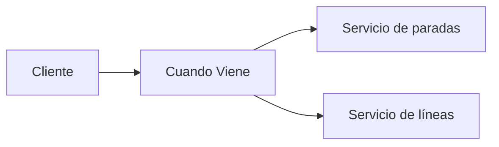

1. Indicá cuál consulta tiene que terminar primero y cuáles pueden solaparse.
2. Escribí pseudocódigo con `asyncio` que cumpla las reglas del enunciado.
3. Si la tarea raíz pertenece a un WebSocket de monitoreo y se cierra la pestaña, ¿qué limpiás? ¿Desaparece una solicitud que ya había llegado al servicio remoto?

<details data-pagefind-ignore>
<summary>Ver pseudocódigo y comportamiento ante fallas</summary>

Primero `parada = await buscar_parada(id)`. Recién ahí se conocen las líneas. Después se agendan juntas y un semáforo limita el tramo que hace I/O.

```python
limite = asyncio.Semaphore(2)

async def consultar_una(linea):
    async with limite:
        try:
            return await consultar_linea(linea)
        except ErrorEsperadoDeLinea:
            return None

resultados = await asyncio.gather(
    *(consultar_una(linea) for linea in parada.lineas)
)
exitos = [respuesta for respuesta in resultados if respuesta is not None]
```

`ErrorEsperadoDeLinea` representa el error de red o de respuesta que la aplicación decidió tolerar. Se maneja dentro de cada consulta para conservar el resultado de 15 y 44 en ese orden. Un `TaskGroup` también sirve si manejás ese fallo esperado dentro de la hija. Si la hija deja escapar un fallo inesperado, el grupo cancela a las demás pendientes.

Al cerrar el WebSocket, cancelá y esperá la limpieza de la tarea de monitoreo y sus hijas. Liberá conexiones o recursos mediante el administrador de contexto o `finally`. La cancelación local no revierte efectos que el otro servicio ya aplicó.

</details>

### 3. Haskell · Elegí entre Functor, Applicative y Monad

Un formulario trae dos cantidades como texto. Para leer usá `leer :: String -> Maybe Int`. Además hay una función `mitadExacta :: Int -> Maybe Int` que devuelve `Nothing` si el número es impar.

1. Leé `"4"` y sumale uno al número, si existe.
2. Leé `"4"` y `"2"` por separado y sumalos, solo si ambos son válidos.
3. Leé un único texto y obtené su mitad exacta. Probá mentalmente con `"4"`, `"5"` y `"x"`.
4. Usá una ley para simplificar `fmap id (leer "4")` y otra para simplificar `leer "4" >>= pure`.

<details data-pagefind-ignore>
<summary>Ver código ejecutable y leyes</summary>

```haskell
import Text.Read (readMaybe)

leer :: String -> Maybe Int
leer = readMaybe

mitadExacta :: Int -> Maybe Int
mitadExacta n
  | even n = Just (n `div` 2)
  | otherwise = Nothing

main :: IO ()
main = do
  print (fmap (+ 1) (leer "4"))
  print ((+) <$> leer "4" <*> leer "2")
  print (map (\texto -> leer texto >>= mitadExacta) ["4", "5", "x"])
```

Las salidas son `Just 5`, `Just 6` y `[Just 2, Nothing, Nothing]`. El primer caso transforma un valor con `fmap`. El segundo combina dos lecturas independientes con `<*>`. En el tercero, el número leído determina si el segundo paso tiene un resultado, así que usamos `>>=`. Con un texto inválido, el segundo paso no corre.

Por **identidad de Functor**, `fmap id x` equivale a `x`. Por **identidad derecha de Monad**, `m >>= pure` equivale a `m`. En ambos casos dados, se simplifica a `leer "4"`.

</details>

### 4. STM · Dos retiros, un saldo y una espera

Las TVars `origen` y `destino` empiezan en **10** y **0**. Dos tareas, T1 y T2, intentan mover **7** de origen a destino. Cada una lee el saldo, comprueba si alcanza, debita y acredita en un solo `atomically`. En la intercalación del ejercicio, las dos leen 10 antes del primer commit y T1 confirma primero. La comprobación de saldo usa `check`.

<figure class="practice-diagram">
  <figcaption>Estado antes de confirmar</figcaption>
  <div class="practice-panels">
    <div class="practice-panel"><strong>Memoria confirmada</strong>Origen 10 · Destino 0</div>
    <div class="practice-panel"><strong>T1</strong>Leyó 10 · intenta mover 7</div>
    <div class="practice-panel"><strong>T2</strong>Leyó 10 · intenta mover 7</div>
  </div>
</figure>

1. Dibujá qué publica T1 y qué ve T2 en su siguiente intento.
2. ¿Qué diferencia hay entre el primer reintento de T2 y lo que sucede cuando encuentra saldo insuficiente?
3. Si luego otro proceso suma **4** a origen en otra transacción y no hay más cambios, ¿cuál es el estado final?
4. Si cada retiro debe emitir una notificación, ¿dónde ubicarías ese efecto?

<details data-pagefind-ignore>
<summary>Ver la validación y los estados finales</summary>

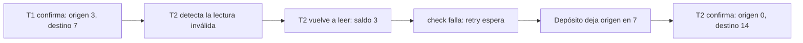

Las escrituras tentativas de T2 no se aplican cuando su primera lectura queda desactualizada. Vuelve a ejecutar desde el inicio. Al leer **3**, `check` llama a `retry` y la transacción se suspende hasta que pueda reevaluar una dependencia. Cuando el depósito confirmado deja el saldo en **7**, T2 puede moverlo y el resultado es **(0, 14)**.

La notificación pertenece a `IO`, fuera de la transacción STM. Si alcanza con notificar después del éxito, hacelo cuando `atomically` retorne. Si debe sobrevivir a la caída de un proceso entre el commit y el envío, necesitás que ese pendiente se guarde de forma durable con el cambio y un consumidor que pueda reintentar.

</details>

### 5. Actor de inventario · Protocolo y timeout ambiguo

Un GenServer mantiene un stock de **1**. Dos clientes hacen `call(:leer)`. Ambos reciben 1 y calculan afuera qué escribir. Cada cliente envía después un pedido para guardar 0 y registra una reserva como exitosa.

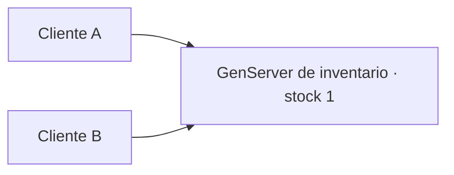

1. ¿Cómo puede haber dos reservas si el proceso atiende un solo mensaje por vez?
2. Diseñá un mensaje que agrupe la decisión con la modificación.
3. Si el cliente pierde la respuesta y reintenta, ¿qué dato debe incluir? ¿Cómo cambia el diseño si el proceso puede reiniciarse?

<details data-pagefind-ignore>
<summary>Ver el protocolo y una secuencia posible</summary>

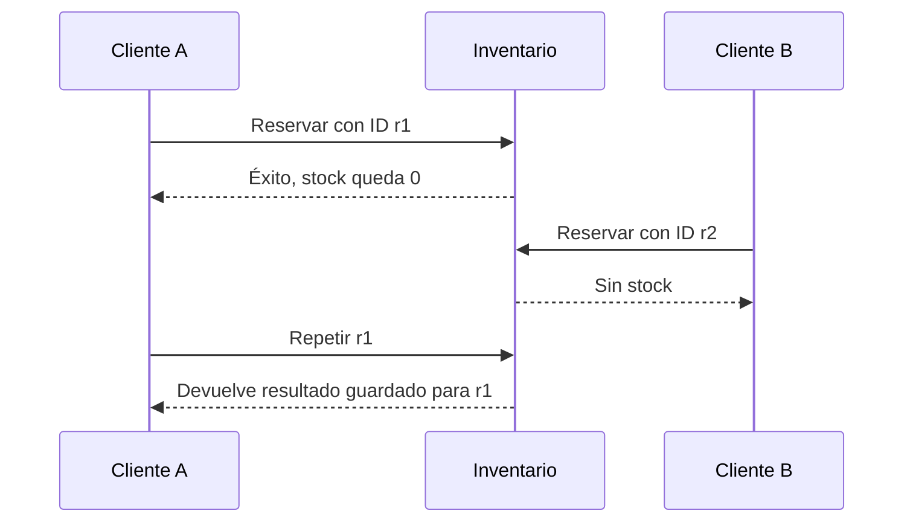

Con lecturas y escrituras separadas, ambas lecturas pueden ocurrir antes de la primera escritura. Terminar con stock 0 no prueba que se haya vendido una sola unidad. El protocolo tiene que enviar `{:reservar, id_operacion}`. El actor verifica la disponibilidad, actualiza y decide el resultado en el mismo paso.

El cliente reintenta **con el mismo ID**. Si el primer pedido se aplicó y luego se perdió la respuesta, el servidor devuelve su resultado anterior. Para sostener la garantía tras un reinicio, el inventario y la deduplicación deben persistir con una frontera consistente. Un Registry permite encontrar al nuevo actor, pero no conserva esos datos.

</details>

### 6. Monitor, link y árbol con dependencias

Un supervisor raíz inicia un Registry, un supervisor dinámico de jobs y un supervisor estático S en ramas separadas. Los hijos permanentes de S se inician en este orden: **A** abre el recurso, **B** depende de A, **C** depende de B. Un observador externo M usa `Process.monitor(b_pid)`.

<figure class="practice-diagram">
  <figcaption>Dependencias dentro de S</figcaption>
  <div class="practice-panels">
    <div class="practice-panel"><strong>A</strong>Abre el recurso</div>
    <div class="practice-panel"><strong>B</strong>Depende de A</div>
    <div class="practice-panel"><strong>C</strong>Depende de B</div>
  </div>
</figure>

1. Si B falla, compará qué hijos se reinician con `:one_for_one`, `:one_for_all` y `:rest_for_one`. Elegí la estrategia que respeta estas dependencias con el menor reinicio.
2. ¿Qué recibe M? ¿Qué diferencia habría si solo tuviera un link y no capturara salidas?
3. ¿Qué debería hacer M si quiere observar al reemplazo? ¿Qué sucede con Registry si S cae y raíz usa uno a uno?

<details data-pagefind-ignore>
<summary>Ver el árbol, los reinicios y el efecto del monitor</summary>

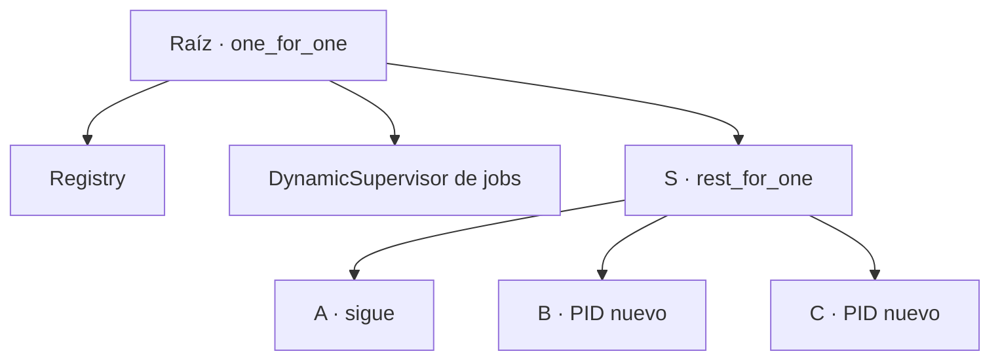

- **Uno a uno:** se reinicia B, C sigue con su dependencia potencialmente inválida.
- **Uno a todos:** se reinician A, B y C.
- **Rest for one:** se reinician B y C, que se inició después. Es la estrategia apropiada si los reemplazos deben reconstruir sus dependencias y A sigue sano.

M recibe `{:DOWN, ref, :process, b_pid, motivo}` por la instancia anterior y sigue. Un link con salida anormal podría terminar a M si este no captura salidas. Para seguir al reemplazo, M vuelve a resolver la clave lógica de B y crea un monitor para el nuevo PID. El Registry, como rama independiente, sigue vivo cuando la raíz reinicia S con uno a uno.

</details>


### 7. Buscador de imágenes · Límites, fallas y reintentos

Un archivo de enlaces pesa más de lo que entra en memoria. Hay enlaces repetidos y el equipo acepta **hasta cuatro descargas activas en total**, con **una por dominio**. Una descarga puede volver a intentarse **tres veces después del primer intento**. Si un dominio supera cinco fallas en un minuto, se lo deja en pausa durante un minuto.

<figure class="practice-diagram">
  <figcaption>Primeros enlaces que llegaron del archivo</figcaption>
  <div class="practice-panels">
    <div class="practice-panel"><strong>Dominio A</strong>a1 · a2 · a3</div>
    <div class="practice-panel"><strong>Dominio B</strong>b1 · b2</div>
    <div class="practice-panel"><strong>Dominio C</strong>c1</div>
  </div>
</figure>

1. Diseñá el flujo de procesos. ¿Dónde se controla cada límite?
2. Marcá qué enlaces podrían estar ejecutándose juntos al principio. ¿Se puede usar el cuarto cupo?
3. Separá el contador de intentos por enlace de la intensidad de reinicio de OTP.
4. Explicá cómo evitás duplicados si una descarga escribe un archivo y cae antes de confirmar.

<details data-pagefind-ignore>
<summary>Ver un flujo posible y sus garantías</summary>

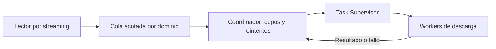

El lector cede trabajo a medida que hay capacidad, sin cargar el archivo entero. El coordinador conserva el máximo global, los dominios activos, contadores por enlace y timestamps de fallas por dominio. Los workers descargan y devuelven un resultado. Usá tareas supervisadas y observadas de forma que una caída aislada llegue al coordinador sin terminarlo por un link.

Pueden arrancar **a1, b1 y c1**. Un cuarto trabajo necesitaría otro dominio disponible. El coordinador debe decidir qué hacer si la cola se llena, por ejemplo dejar de pedir más ítems del flujo hasta liberar capacidad.

Cada enlace tiene como máximo **cuatro intentos totales**. Si un hijo se reinicia por supervisión, eso no incrementa por sí mismo la cuenta correcta de un enlace. El coordinador es quien decide cuándo repetir un trabajo y cuándo suspender un dominio. Registrá cada fallo con su hora, retirando los que queden fuera del minuto relevante.

Usá un ID estable y una ruta de salida derivada de ese ID. Escribí primero en un archivo temporal y, donde el sistema de archivos lo permita, publicalo con un renombrado atómico. Si el worker cae después de publicar, el próximo intento puede reconocer y validar el resultado ya existente.

</details>

### 8. Url Shortener · El PID cambia, la URL sigue

Los nodos A, B y C ejecutan un acortador. El proceso de una URL vive en A. B ya respondió a un cliente con el enlace **u42**. A queda fuera de servicio y un proceso con la misma clave lógica arranca en C.

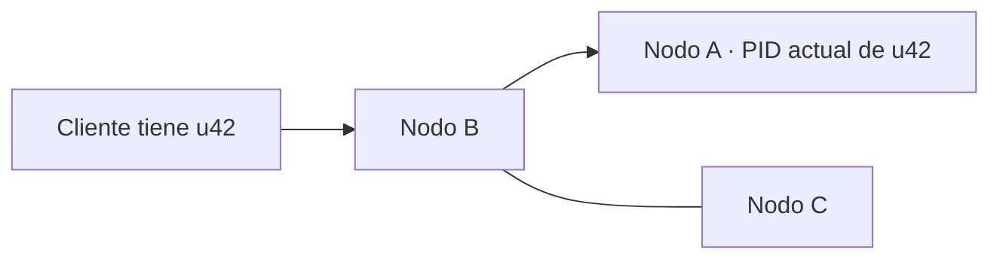

1. ¿Qué resuelve libcluster? ¿Qué aportan Horde.Registry y Horde.DynamicSupervisor?
2. Si A guardaba el enlace en una ETS local, ¿puede C recuperarlo solo con el dato del Registro?
3. Elegí cómo conservar el vínculo de **u42** si la garantía exige que siga luego de perder A. ¿Cuándo devolverías éxito?
4. Si A en realidad quedó aislado y siguió activo, ¿qué regla impediría que dos actores asignen resultados incompatibles?

<details data-pagefind-ignore>
<summary>Ver un diseño de recuperación y las responsabilidades</summary>

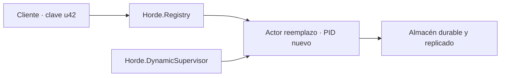

**libcluster** descubre y conecta nodos. **Horde.Registry** ayuda a resolver la clave lógica y **Horde.DynamicSupervisor** ubica o recrea trabajadores conforme a su estrategia. El proceso nuevo no hereda la memoria de A. ETS en A puede ayudar ante la caída de un trabajador dentro de A si sobrevive el dueño de la tabla, pero no alcanza ante la pérdida del nodo.

Guardá el mapeo en almacenamiento durable que sobreviva a la caída prevista. Confirmá al cliente **después** de lograr la durabilidad comprometida, por ejemplo cuando el almacén haya confirmado el cambio de acuerdo con su política de réplica. Al iniciar, C reconstruye el estado desde ese almacén.

Si hay dos candidatos a dueño durante una partición, una **restricción única y escritura coordinada** en el almacén puede arbitrar el valor de `u42`. Otra opción es un dueño por clave con quórum y un token de liderazgo que el almacén compruebe. Si un lado no puede confirmar autoridad, no acepta una escritura que viole esa garantía. La convergencia del registro no actúa como bloqueo global.

</details>

### 9. Escalabilidad · Encontrá el cuello antes de dividir

Una tienda tiene tres copias de su API detrás de un balanceador. En el pico, cada API usa 30 % de CPU y la base compartida usa 95 %. Las sesiones viven en memoria local de cada API. Catálogo recibe muchas lecturas y casi todas las escrituras nuevas corresponden a pedidos recientes.

| Señal | Observación |
| --- | --- |
| API | 30 % de CPU en cada una de tres copias. |
| Base | 95 % de CPU. Las consultas se encolan en el pico. |
| Sesiones | Viven dentro del proceso de la API. |
| Patrón de escritura | Se concentra en pedidos recientes. |

1. ¿Sumar dos copias de la API alivia la base? Identificá los ejes X, Y y Z con ejemplos de esta tienda.
2. Si la carga de catálogo permite atraso, proponé una primera intervención concreta.
3. Compará particionar pedidos por rango de fecha y por hash de ID. ¿Qué pierden o ganan las consultas por fechas?
4. Una API nueva tarda 20 segundos en preparar su caché. ¿Qué debería indicar durante ese lapso una sonda de readiness y una de liveness si el proceso funciona?

<details data-pagefind-ignore>
<summary>Ver una arquitectura y las decisiones de escalado</summary>

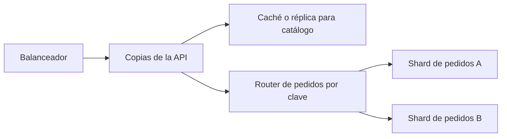

**X** clona instancias de la API. **Y** separa Catálogo de Pedidos para que escalen distinto. **Z** divide los registros por una clave de ruteo. Agregar copias de la API por sí solo no aumenta la capacidad de la base. Para las sesiones, podés usar un estado compartido o un mecanismo que no dependa de una instancia particular. La afinidad del balanceador puede ayudar, pero si una instancia cae su memoria se pierde.

Si las lecturas toleran atraso, intentá descargar las más frecuentes hacia una **caché o réplica**, medí qué porcentaje deja de golpear al primario y controlá el atraso. La consulta rara que sigue saturando la base merece diagnóstico por separado.

Por **fecha**, una búsqueda por rango puede visitar pocos shards. Las escrituras nuevas golpean el shard más reciente. Por **hash de ID**, las escrituras de muchos pedidos se reparten, pero un informe por fecha puede necesitar consultar varios shards. Una sola clave con mucho tráfico puede seguir siendo caliente.

Mientras se inicializa, la instancia puede decir **viva** y **no lista**. El balanceador espera antes de enviarle tráfico. Una sonda de liveness debería detectar si recuperarla mediante un reinicio tiene sentido. Una demora esperada de arranque no es por sí misma motivo para reiniciarla.

</details>

### 10. Coordinación · Raft, 2PC y 3PC

Cinco réplicas de un shard se dividen en dos grupos. El líder anterior está en el grupo de dos y allí una entrada nueva aparece en **dos logs**. El grupo de tres puede comunicarse. Después, una transacción cruza dos shards. Ambos participantes de 2PC votaron sí, pero uno solo sabe que quedó preparado y todavía no recibió la decisión.

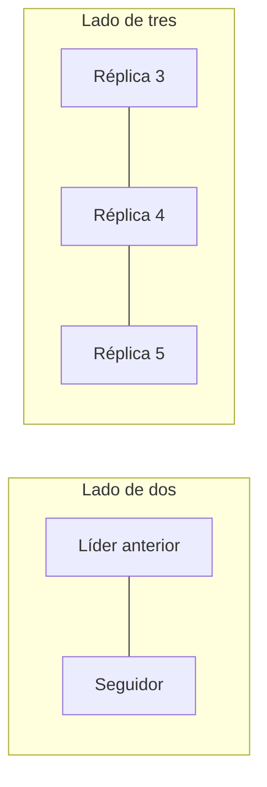

1. ¿Dos logs alcanzan para dar éxito en Raft? ¿Qué puede hacer el grupo de tres?
2. ¿Qué debería hacer el participante preparado en 2PC si vence el timeout?
3. ¿La fase extra de 3PC garantiza una decisión segura y disponible si la red puede partirse indefinidamente?
4. ¿Dónde combinarías Raft y commit distribuido en un sistema con shards?

<details data-pagefind-ignore>
<summary>Ver el criterio de decisión y los modelos de falla</summary>

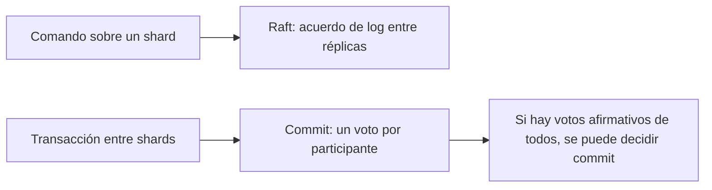

Con cinco miembros, **dos no forman mayoría**. El líder anterior no puede confirmar una entrada nueva en ese lado. El grupo de tres puede elegir un líder que cumpla las reglas de Raft y avanzar si se estabiliza. Una entrada del término actual se puede confirmar al replicarse en una mayoría. Una entrada vieja encontrada en unos pocos logs puede quedar sin commit y no debe tratarse como confirmada.

En **2PC**, el preparado no puede elegir unilateralmente. El coordinador podría haber registrado una decisión durable y haberla comunicado a otro shard. Debe recuperar la decisión mediante el protocolo previsto o esperar. **3PC** agrega una etapa de preconfirmación que ayuda bajo supuestos más fuertes sobre tiempos y fallas. No elimina el problema de las particiones arbitrarias.

Podés replicar el log **dentro de cada shard** con Raft y usar commit distribuido **entre shards**. Una mayoría dentro de un shard no sustituye el voto de otro participante de la transacción.

</details>

### 11. CAP y CRDT · Reacciones e inventario

Durante una partición, dos réplicas A y B siguen recibiendo tráfico. En una publicación, A registra dos reacciones y B tres. Para un artículo distinto, cada réplica había leído que quedaba **una sola unidad de inventario**.

1. Modelá las reacciones con un G-Counter. ¿Qué resultado se ve en cada lado durante la partición y cómo se fusiona después?
2. ¿Qué pasa si B manda dos veces el mismo estado? ¿Cómo cambia la consigna si se pueden quitar reacciones?
3. ¿Pueden A y B autorizar la venta de la última unidad durante la partición, conservar la regla de inventario y confirmar sin coordinar? Proponé una política para este caso.
4. ¿Podés dar una garantía de lectura distinta en las reacciones y en las reservas?

<details data-pagefind-ignore>
<summary>Ver la fusión y una política por operación</summary>

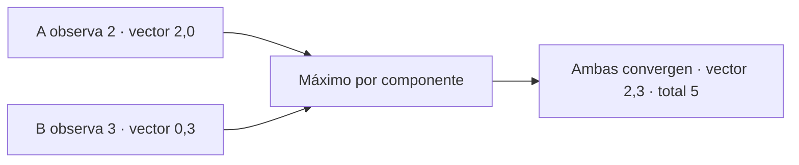

Cada réplica aumenta solo su componente. Antes de recibir cambios, A ve **2** y B **3**. Después del intercambio, `max([2,0], [0,3]) = [2,3]` y el total es **5**. Repetir el mensaje de B no cambia el máximo. Si se quiere representar altas y bajas de un contador, se puede usar un **PN-Counter**. Si cada usuario puede reaccionar como máximo una vez y luego deshacerlo, hace falta modelar identidades y la semántica de altas y bajas, por ejemplo con un tipo de conjunto replicado y una política de conflictos explícita.

Las dos réplicas podrían ver stock 1 y vender 2 si autorizan de forma independiente. Para la última unidad reservá a través de un dueño o quórum autorizado, o asigná permisos de inventario previamente repartidos de modo que solo un lado tenga el permiso para esa unidad. El lado sin permiso debe rechazar o demorar la reserva. Podés aceptar una vista eventualmente consistente para las reacciones y exigir una decisión coordinada para las reservas.

</details>

### 12. Relojes físicos, causalidad y orden de entrega

En un intercambio NTP, el cliente envía en `t1 = 1000 ms`, el servidor recibe en `t2 = 1060 ms`, responde en `t3 = 1070 ms` y el cliente recibe en `t4 = 1040 ms`. Cada nodo mide con su propio reloj.

En otro escenario, A y B empiezan con Lamport 0 y vector `[0,0]`. A manda **m1**. B registra un evento local, recibe **m1** y después difunde **m2**, una respuesta que depende de **m1**. Por otra ruta, C recibe **m2** antes que **m1**.

1. Calculá la demora estimada de ida y vuelta y el desfase estimado del servidor respecto del cliente.
2. Calculá Lamport y los vectores de los cuatro eventos entre A y B. ¿Son comparables los dos eventos iniciales?
3. ¿Qué entrega C con orden causal? ¿FIFO por emisor alcanza? ¿Qué garantía adicional requiere un broadcast de orden total si todos los correctos deben entregar?
4. Si se mide un timeout en el cliente y NTP ajusta su hora de pared, ¿qué reloj conviene usar para medir ese intervalo?

<details data-pagefind-ignore>
<summary>Ver los cálculos y el orden de entrega</summary>

**Demora:** `(t4 − t1) − (t3 − t2) = 40 − 10 = 30 ms`.

**Desfase estimado:** `((t2 − t1) + (t3 − t4)) / 2 = (60 + 30) / 2 = +45 ms`. El signo positivo indica que el servidor parece adelantado. Es una estimación que supone demoras comparables en ambas direcciones.

| Evento | Lamport | Vector [A, B] |
| --- | --- | --- |
| A envía m1 | 1 | `[1,0]` |
| B registra su evento local | 1 | `[0,1]` |
| B recibe m1 | 2 | `[1,2]` |
| B envía m2 | 3 | `[1,3]` |

Los vectores iniciales son incomparables. Al recibir, B fusiona por máximo y luego incrementa su propio componente. La respuesta de B sí depende del envío de A.

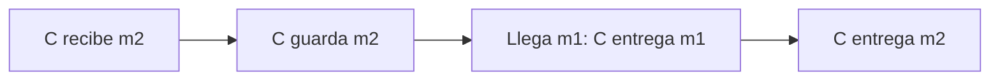

FIFO solo conserva el orden de mensajes de **un mismo emisor**, por eso no alcanza. Orden total asegura una secuencia común para quienes entregan ambos mensajes. Para que todos los correctos los entreguen se necesitan las garantías de un broadcast confiable bajo el modelo de fallas asumido. Un algoritmo de reenvío a todos con deduplicación puede dar confiabilidad ante caídas bajo las hipótesis correspondientes, pero no impone por sí solo orden causal o total.

Para medir un timeout local, restá dos lecturas del **reloj monotónico** del cliente. Los timestamps lógicos no miden duración.

</details>

## Mapa de repaso

Si te trabaste en un ejercicio, buscá el concepto correspondiente y resolvé el mismo problema otra vez con la respuesta cerrada.

| Si fallaste en… | Volvé a… |
| --- | --- |
| Núcleos, bloqueo, hilos y GIL | [Nociones fundamentales](/introduccion/03-nociones-fundamentales/) y [Green threads, hilos y procesos](/introduccion/06-green-threads-vs-os-threads/) |
| Consultas concurrentes, `await` o cancelación | [Corrutinas y laboratorio](/corutinas/corrutinas-y-laboratorio/) y [Ejemplos en Python](/ejemplos/corrutinas/) |
| `fmap`, `<*>`, `>>=` o leyes | [Programación funcional](/funcional/fundamentos/) |
| `atomically`, validación o `retry` | [Software Transactional Memory](/stm/fundamentos/) |
| Buzón, estado, errores, PID o árbol OTP | [Actores y manejo de errores](/elixir/01-actores-y-elixir/) y [Supervisión](/elixir/02-supervision/) |
| Colas de descarga y reintentos | [Laboratorio de supervisión](/elixir/03-laboratorio-supervision/) |
| Nodos, nombres y reconstrucción del estado | [Distribución en Elixir](/elixir/04-distribucion/) y [Laboratorio de distribución](/elixir/05-laboratorio-distribucion/) |
| Sharding, réplicas, healthcheck o cuellos de botella | [Introducción y patrones de distribución](/distribucion/01-introduccion-y-patrones/) |
| Raft, 2PC, CAP o CRDTs | [Comunicación, coordinación y consistencia](/distribucion/02-comunicacion-y-consistencia/) |
| NTP, vectores o broadcast | [Relojes y broadcast](/distribucion/03-relojes-y-broadcast/) |
